# Etkinlik Keşif — MOBILAB / SKYLAB

MOBILAB'ın 7 günlük Flutter görevi için gerçek etkinlik API'sini kullanan mobil uygulama. Giriş yapmadan keşif, sunucuda arama/kategori filtresi, %70 eşikli sayfalama, detay ve hesap bazlı Supabase favorileri içerir.

**Son ürün deneyimi:** Her cold start’ta 2.2 saniyelik özgün logo intro’su, yüzen navigasyon, kaydırmayla daralan büyük başlıklar ve tek fotoğraf yüzeyli sinematik etkinlik detayı. Güncel kaynak/Git çalışma ağacı `Etkinlikler` klasöründedir. Bu son geliştirmede commit/push yapılmadı.

## Son tasarım ve hareket

Orijinal yeşil 3D M PNG’si `assets/branding/mobilab_logo.png` olarak değiştirilmeden kullanılır. Perspective/scale yaklaşma, kontrollü overshoot ve çok küçük sarsıntıyı ince dallanan `CustomPainter` çatlakları izler. 2.2 saniyelik intro uygulama kökünde bir kez çalışır: cold start’ta tekrar oynar; sekme, route, hot reload veya kısa süreli arka plan dönüşünde yeniden başlamaz. Reduced motion ile 360ms sade fade kullanılır. API/Supabase hazırlığı intro ile paraleldir; intro ağ yanıtını beklemez. Native başlangıç arka planı aynı kırık beyaz tondadır.

İlk kullanımda **Intro → Onboarding 1 → Onboarding 2 → Keşfet**; `onboarding_completed_v1` tamamlandıysa **Intro → Keşfet** akışı kullanılır. Auth oturumu korunur. Kayıtlı tercihi ve oturumu silmeden, yalnızca debug’da önizlemek için:

```sh
flutter run -d "iPhone 17" --dart-define-from-file=config/supabase.local.json --dart-define=FORCE_ONBOARDING=true
```

Keşfet/Favoriler alt barı yatay margin, hafif gölge ve SafeArea ile ayrılır; içerik için yer ayırdığı için son satırı kapatmaz. Klavye açıldığında gizlenir. `IndexedStack` sekme, liste, filtre ve scroll state’ini korur. Her iki listenin büyük başlığı `SliverPersistentHeader` geometrisiyle 34px’ten kompakt 20px’e daralır. Arama/kategori ayrı sliver’da daha yavaş yükselip tamamen kliplenir; ters kaydırmayla geri gelir. TextField aynı ağaçta kalır. 350ms debounce, pull-to-refresh ve güncel scroll extent’in %70’inde pagination korunur.

### Tek yüzeyli sinematik detay

Detayda ayrı dikdörtgen foreground fotoğrafı yoktur. API’nin gerçek `imageUrl` fotoğrafı ekranı kaplayan tek atmosferik yüzeydir; başlık, tarih/saat, konum, kategori, varsa düzenleyen ve tam açıklama doğrudan bu yüzeye yerleşir. `GET /events/{id}` güncel yanıtı cached liste bilgisinin önüne geçer. Olmayan organizer, bilet veya fiyat üretilmez.

Gerçek oran, aynı `ImageProvider` / `ImageStream` tarafından decode edilen piksel boyutlarından bulunur: landscape ≥1.3, portrait <0.85, arası square. URL adına göre tahmin veya ek metadata HTTP isteği yoktur. Tek `RawImage`, Flutter ImageCache’i ve en fazla 1200×1600 decode sınırı kullanılır; düşük çözünürlük büyütülerek decode edilmez. URL değişince eski listener çıkarılır ve generation kontrolü geç yanıtları reddeder.

Yatay fotoğrafı dikey ekrana doldururken yanlardan kayıp geometrik olarak kaçınılmazdır. Son tasarım kararı bu crop’u bilinçli kabul eder; tek `BoxFit.cover` yüzeyi oranı bozmadan merkezden kırpar, ek zoom uygulamaz. Önceki beğenilen zümrüt/tonal atmosfer ve hafif sigma 5 blur korunur. Karede sigma 3, portrede sigma 1 kullanılır. Focal point varmış gibi davranılmaz. Sert kenarlı ikinci kopya veya stok arka plan yoktur.

Sabit koyu scrim, en parlak beyaz fotoğrafta bile beyaz metin için en az 4.5:1 kontrast sağlar. Açıklama hafif transparan yüzeydedir, satır sınırı yoktur. Tek scroll bütün uzun içeriğe eriştirir; üst geri/kalp ve alt güvenli alan korunur. Null/bozuk fotoğrafta nötr koyu yüzey ve gerçek bilgiler kullanılabilir kalır. Detay geçişi 220ms fade’dir; tam ekran crop’a zorlanan Hero esnemesi kullanılmaz. Reduced motion’da route süresi sıfırdır.

Ana ekran/onboarding/auth tema stilini `AnnotatedRegion<SystemUiOverlayStyle>` belirler; fotoğraf detayının AppBar’ı açık ikonları açıkça ister. Detaydan geri dönünce açık temanın koyu, koyu temanın açık durum çubuğu geri gelir. Intro kendi açık zeminine uygun koyu ikonları kullanır.

**Son doğrulama: 209/209 test başarılı; `flutter analyze`: No issues found.**

| Tek yüzeyli gerçek API detayı | Açık temada geri dönüş | Daralmış başlık |
| --- | --- | --- |
| 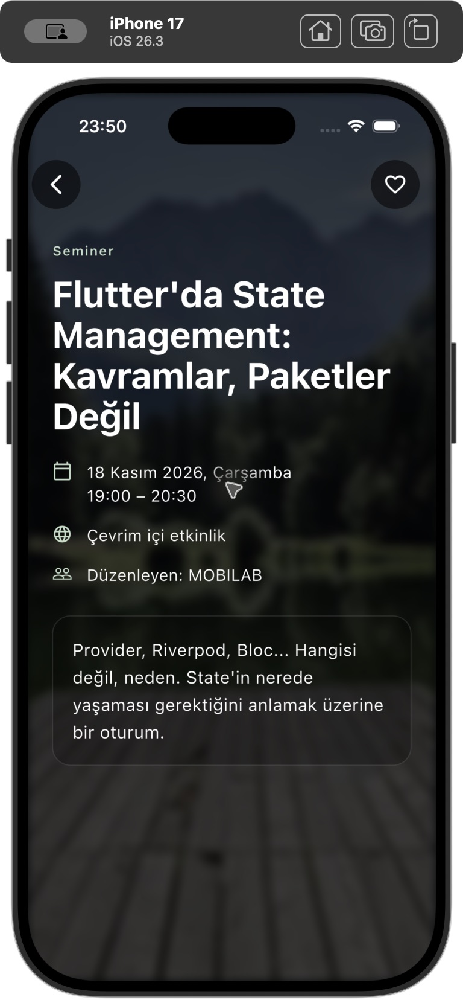 | 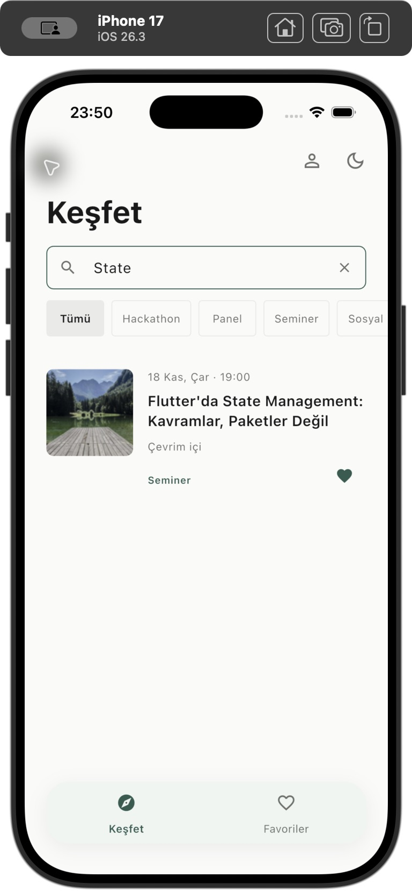 | 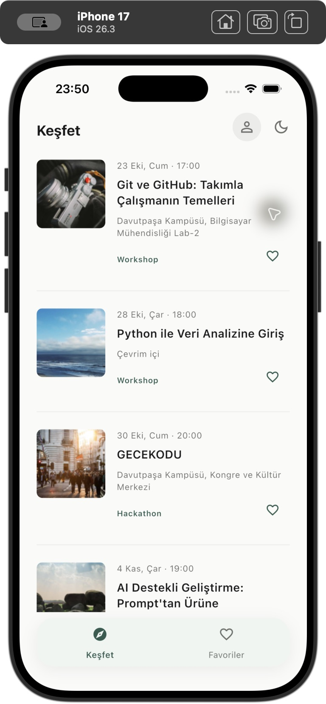 |

[Son teknik rapor, test kapsamı ve simülatör kanıtları](docs/reports/final-motion/rapor.md).


## Gerçek ekran görüntüleri

Bu ilk üç görüntü Aşama 4'te iPhone 17 / iOS 26.3 üzerinde alınmıştır. Aşama 5'in yeni loading/loaded görüntüleri sonraki bölümdedir. Kamuya açık API verisi kullanılır; ekranlarda kişisel e-posta veya OTP yoktur.

| Keşfet | Arama + kategori, koyu tema | Etkinlik detayı |
| --- | --- | --- |
| 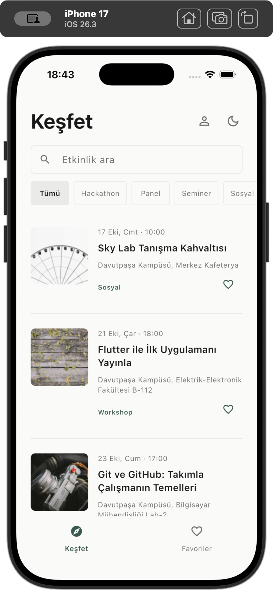 | 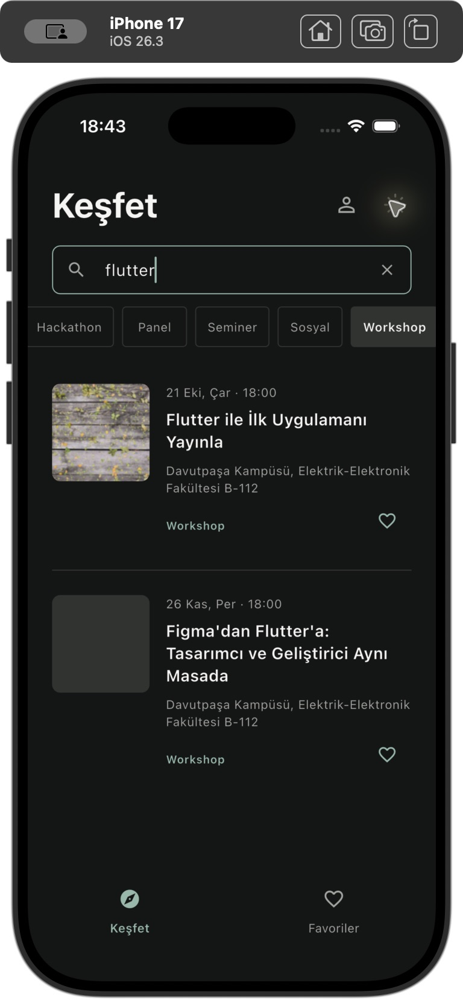 | 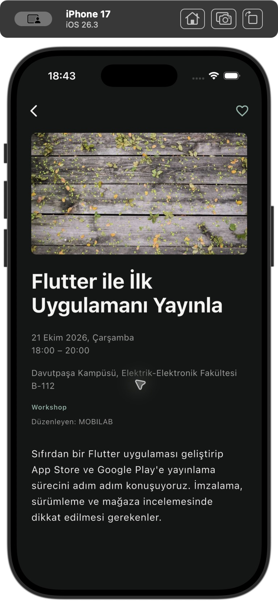 |

[Aşama 5 görüntüleri ve teknik rapor](docs/reports/asama5/rapor.md) · [Aşama 4 raporu](docs/reports/asama4/rapor.md) · [Önceki onboarding görüntüleri](docs/reports/asama3/rapor.md)

Aşama raporları geliştirme sırasında alınan tarihî kayıtlardır. Güncel teslim ve doğrulama durumu bu README’dedir.

## Skeleton ve yükleme deneyimi

`lib/core/widgets/skeleton.dart` içindeki SkeletonBlock, EventRowSkeleton, EventDetailSkeleton ve CategorySkeleton ortak tema renkleri/8px boşluk sistemi kullanır. Liste ve Favoriler ilk yüklemesinde üç satır EventListSkeleton ile sunulur. 96px kapak, tarih, iki başlık satırı ve konum geometrisi korunur. Kategorilerde Tümü kullanılabilir kalır; ilk yüklemede üç nötr placeholder vardır. Hata/empty durumunda skeleton kaldırılır.

Aramada mevcut 350ms debounce korunur. Yazarken eski sonuçlar gizlenir; debounce sırasında yeni skeleton kurulmaz. İstek başlayınca tek statik yükleme ağacı kullanılır. Frame oluşmadan tamamlanan hızlı yanıt skeleton flaşı üretmez; ek UI timer'ı veya cache katmanı eklenmedi. Pagination gerçek listeyi koruyup yalnızca küçük footer yüklemesini gösterir. Favori ekleme/kaldırmada yalnızca ilgili kalp pending olur.

Detayda bilgi yoksa atmosferik nötr yüzey üzerinde metin skeleton’ı; mevcut Event varsa gerçek başlık/fotoğraf hemen gösterilir, eksik açıklama bölümü yükleme bildirimi alır. Null/bozuk görsel aynı boyutta nötr placeholder kullanır; URL/key/cache davranışı korunur. OTP için tam ekran skeleton kullanılmaz, mevcut buton loading'i kalır.

Skeleton'lar etkileşimsizdir. Ekran okuyucu her bloğu değil tek anlamlı yükleme etiketini alır. Skeleton üzerinde shimmer veya animasyon yoktur; yeni paket eklenmedi.

| Keşfet loading — debug | Detay içeriği — debug | Favoriler loading — debug |
| --- | --- | --- |
| 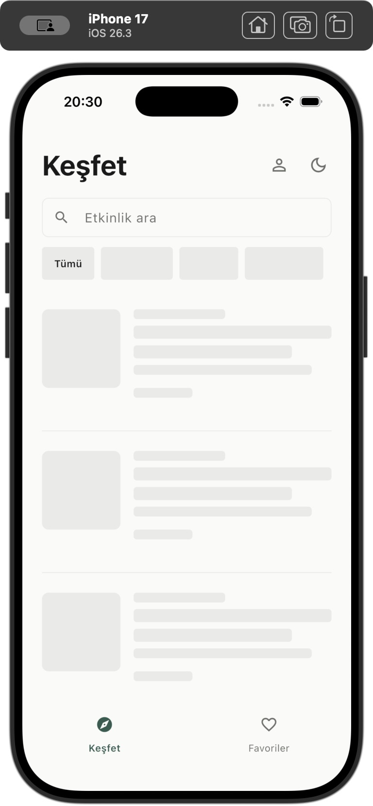 | 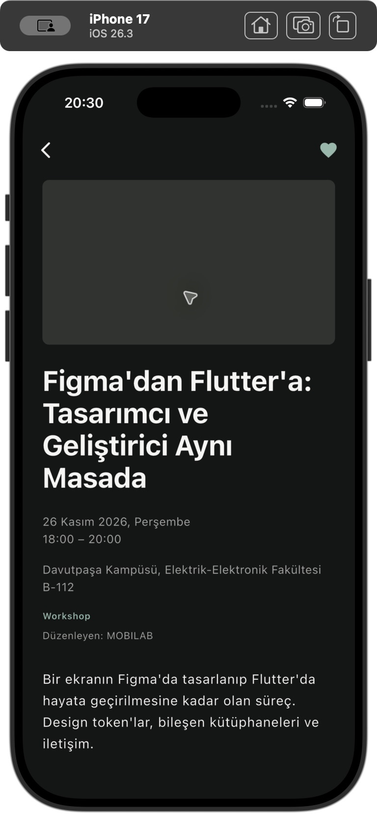 | 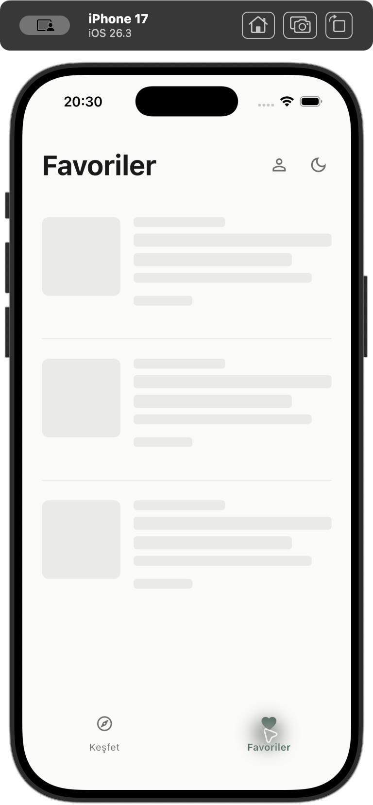 |

| Keşfet loaded — normal uygulama | Detay loaded — normal uygulama | Koyu skeleton — debug |
| --- | --- | --- |
| 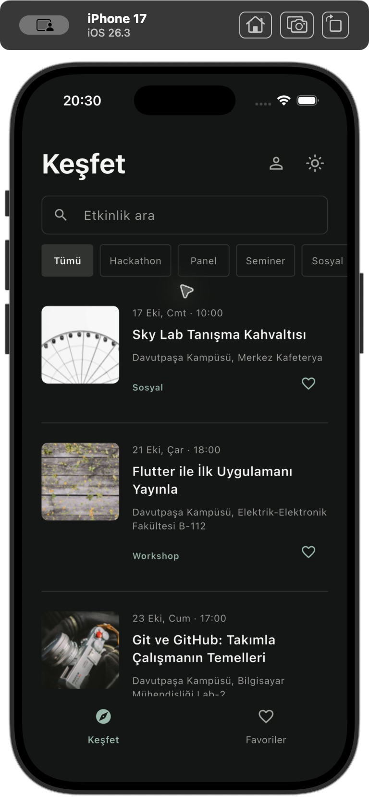 |  | 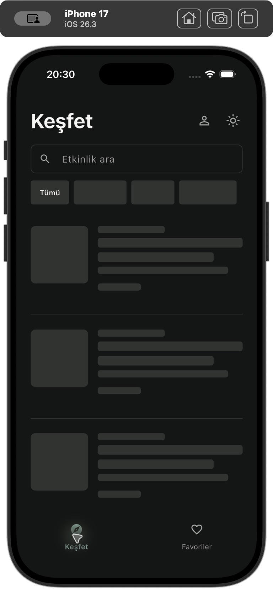 |

`06-detay-loading-koyu-debug.png` dosyası, adına rağmen açıklaması yüklenmiş detay ekranını gösterir; nötr görsel alanı API’deki null fotoğrafın placeholder’ıdır. Bu PNG detay skeleton’ının kanıtı değildir. Detayın tam ve cached skeleton durumları widget testlerinde doğrulanır.

Loading görüntüleri `tool/skeleton_preview.dart` debug girişinden alınmıştır: gerçek API yanıtlarını 30 saniye geciktirir, auth/favorileri bellekte taklit eder; Supabase'e bağlanmaz, session veya tema tercihlerini diske yazmaz. Bunlar canlı Supabase favori testi değildir. Normal uygulama `lib/main.dart` bu dosyayı import etmez ve yapay gecikme içermez. Önizleme yalnızca debug'da çalışır:

```sh
flutter run -d "iPhone 17" -t tool/skeleton_preview.dart --dart-define=PREVIEW_DELAY_MS=30000
```

## Özellikler ve teknoloji

- Gerçek API listesi/fotoğrafları, detay, Türkçe yerel tarih/saat ve placeholder.
- 350ms gecikmeli sunucu araması; gerçek kategorilerle birleşen filtreler.
- Scroll extent'in %70'inde sonraki sayfa; ID ile deduplication, bağımsız devam hatası/retry, pull-to-refresh.
- İki sayfalık, geçilebilir ve cihazda kalıcı onboarding.
- Şifresiz e-posta OTP, 6/8 hane yapılandırması, SDK session saklama/yenilemesi.
- Supabase üzerinde kullanıcıya özel favoriler; Keşfet/Favoriler/detay arasında ortak state.
- Kalp ikonlu Favoriler sekmesi; detaydan geri dönüşte sekme ve scroll korunur.
- Kalıcı açık/koyu tema; tercih yoksa sistem teması; reduced motion'a uyan kısa Hero.
- Secretsiz analyze/test GitHub Actions dosyası.

Flutter **3.47.7 stable**, Dart **3.13.5**, Material 3, null safety. Paketler: `http`, `intl`, SDK `flutter_localizations`, `supabase_flutter` **2.18.3**, `shared_preferences` **2.5.6**. Son tasarımda da yeni paket eklenmedi. ChangeNotifier / ListenableBuilder ve constructor injection kullanılır.

## Kurulum ve çalıştırma

[Resmî Flutter kurulum rehberini](https://docs.flutter.dev/install) izleyip SDK’nin `bin` dizinini PATH’e ekleyin. Yerel doğrulama ve CI ile aynı ortam için [SDK arşivinden](https://docs.flutter.dev/install/archive) Flutter **3.47.7 stable** kullanın; Dart **3.13.5** SDK ile birlikte gelir. iPhone Simulator için macOS, Xcode ve iOS Simulator araçlarını [resmî iOS kurulum rehberine](https://docs.flutter.dev/platform-integration/ios/setup) göre hazırlayın.

Yeni bir checkout oluşturmak için:

```sh
git clone https://github.com/cigdem-gokdas/Etkinlikler.git Etkinlikler
cd Etkinlikler
```

Mevcut checkout’ta `pubspec.yaml` dosyasının bulunduğu proje kökünden başlayın. Son geliştirme ve simülatör doğrulaması orijinal `Etkinlikler` checkout’ında yapıldı; `.git` geçmişi bu klasörde korunuyor. Ardından:

```sh
flutter --version
flutter pub get
flutter doctor
flutter devices
flutter run -d "iPhone 17"
```

Xcode 26’da Simulator’ı `open -a Simulator` ile açabilirsiniz. `-d` değerini `flutter devices` çıktısındaki cihaz adı/ID ile eşleştirin; Chrome için `-d chrome` kullanın. Yerel Supabase config olmadan Keşfet çalışır; OTP ve favoriler için aşağıdaki yapılandırmayı tamamlayın.

### Supabase yapılandırması ve OTP

Yerel dosya yoksa `config/supabase.example.json` dosyasını `config/supabase.local.json` adına kopyalayıp placeholder’ları kendi proje URL’niz ve publishable anahtarınızla doldurun. **Mevcut yerel dosyanın üzerine yazmayın.** Gerçek yerel config Git’e eklenmez. Başka bir dizindeki mevcut config de tam dosya yolu verilerek kullanılabilir.

```json
{
  "SUPABASE_URL": "YOUR_SUPABASE_PROJECT_URL",
  "SUPABASE_PUBLISHABLE_KEY": "YOUR_SUPABASE_PUBLISHABLE_KEY",
  "OTP_LENGTH": 6
}
```

Yapılandırmadan sonra proje kökünden çalıştırın:

```sh
flutter run -d "iPhone 17" --dart-define-from-file=config/supabase.local.json
```

Config tanımları derleme zamanında okunur; değişiklikten sonra uygulamayı tamamen durdurup aynı parametreyle yeniden çalıştırın. Hot reload bu değerleri yenilemez.

Yalnızca istemci publishable key kullanılır. Server/secret/service-role veya Resend/SMTP anahtarları uygulamaya konmaz. Yerel config Flutter asset'i değildir; `.gitignore` ile hariç tutulur. Publishable key istemci paketinden görülebilir; veriyi koruyan asıl sınır RLS'dir. Eksik bağlantı ayarında Keşfet kullanılabilir, auth ekranı sorunu açıklar.

E-posta → Kod gönder → kodu doğrula. `OtpConfig`, `int.fromEnvironment('OTP_LENGTH', defaultValue: 6)` ile tek merkezi uzunluğu sağlar. Controller, input ve açıklama aynı değeri kullanır. Sunucu hâlâ 8 hane gönderiyorsa yerel dosyada `OTP_LENGTH: 8` kullanın; Dashboard Email OTP Length 6 yapıldığında yerel değer de 6 olmalı. Yalnızca 6/8 desteklenir.

Kod String kalır; sıfırlar korunur, trim/int dönüşümü yapılmaz. 8 hane 6'ya kesilmez: yanlış uzunluk açık hata üretir. Numeric keyboard, yapıştırma ve OTP autofill vardır. Kod/token loglanmaz. `verifyOTP(type: OtpType.email)` cevabında gerçek Session oluşmadan başarı sayılmaz. SDK `persistSession` ve `autoRefreshToken` açık, URI session algılama kapalıdır. Her gönderme girişiminde 60 saniye UI beklemesi vardır; servis rate limit'i ayrıca geçerlidir.

“Kod gelmediyse spam klasörünü de kontrol et.” uyarısı korunur. Spam/deliverability, sender/domain doğrulaması ve Resend test adresi kısıtları servis tarafında çözülmelidir. E-posta teslimi veya bu ayarlar Flutter koduyla düzeltilmiş sayılmaz.

## Favoriler ve RLS

Mevcut `public.favorites` tablosu kullanılır:

| Alan | Tip / amaç |
| --- | --- |
| `user_id` | uuid, auth.users foreign key |
| `event_id`, `title` | text |
| `image_url` | nullable text |
| `starts_at` | nullable timestamptz |
| `location`, `category` | nullable text |
| `saved_at` | timestamptz, sunucu varsayılanı now() |

Primary key `(user_id, event_id)`. Eklemede yalnızca mevcut kolonlar gönderilir; `saved_at` sunucuya bırakılır. UPDATE/upsert kullanılmaz. `supabase/favorites.sql` çalıştırılmayan şema/policy referansıdır; mevcut tablo veya policy'ler yeniden oluşturulmadı.

Bildirilen RLS: authenticated SELECT/DELETE için `USING (auth.uid() = user_id)`; INSERT için `WITH CHECK (auth.uid() = user_id)`; anon erişim kapalı olmalı. İstemci filtreleri RLS'nin yerine geçmez. Repository güncel SDK kullanıcı/session eşleşmesini doğrular. Her sorgu user_id; silme ayrıca event_id ile sınırlıdır. DELETE sonrası SELECT, etkisiz kalan silmeyi sahte başarı olarak göstermeyi önler.

Hesap değişince önceki favoriler/pending state temizlenir; eski async yanıtlar generation kontrolüyle reddedilir. Kalp sunucu başarısından sonra değişir. Ağ hatasında önceki veri korunur. Search/kategori değişikliği FavoritesController'ı yeniden oluşturmaz. Aynı etkinliğin kalbi filtreler ve ekranlar arasında tutarlıdır.

## API, arama ve sayfalama

[API](https://mobilab-task-api.vercel.app) · [Swagger](https://mobilab-task-api.vercel.app/docs) · [OpenAPI](https://mobilab-task-api.vercel.app/openapi.json)

| Endpoint | Kullanım |
| --- | --- |
| `GET /categories` | Gerçek `{items: [String, ...]}` kategorileri |
| `GET /events` | `q`, `category`, `online`, `page`, `limit` |
| `GET /events/{event_id}` | String ID ile açıklama dahil gerçek detay |

24 Ekim 2026 canlı kontrolünde toplam 16 kayıt, ilk sayfa 10, ikinci sayfa 6 ve son `hasMore=false` görüldü. `q=flutter` üç; `q=flutter&category=Workshop` iki sonuç döndürdü. API zaman zaman 500 döndürüyor. Fixture'lar gerçek yanıtların test kopyalarıdır; üretimde kullanılmaz.

Kategori değerleri API'deki haliyle (`Workshop`, `Yarışma` gibi) gönderilir. “Tümü” category parametresini kaldırır. Parametreler Uri üzerinden encode edilir; Türkçe, boşluk ve `&` doğru taşınır. `online` repository tarafından desteklenir; bu aşamada ayrı online filtre kontrolü eklenmedi.

Arama 350ms debounce kullanır. Her değişiklikte generation hemen artar; debounce beklerken bile eski yanıt yeni sorguyu ezemez. Arama/kategori birlikte sunucuya gider. Filtre değişiminde liste ve pagination sıfırlanır, page 1 istenir ve scroll başa alınır. Kategori yükleme/hata/retry durumu listeden bağımsızdır.

`CustomScrollView` / `SliverList.builder` + dispose edilen ScrollController kullanılır; görünür scrollbar yoktur. `pixels >= maxScrollExtent * 0.70` koşulunda devam yüklenir. Controller şu korumaları uygular:

- İlk yükleme veya loadMore devam ederken ikinci devam isteği açılmaz.
- Başarısız sayfada page ilerlemez; hata sonrası otomatik retry fırtınası olmaz, footer aynı sayfayı yeniden deneyebilir.
- Event ID ile ilk ve sonraki sayfalar deduplicate edilir.
- Gerçek `hasMore=false`, total sınırı veya ilerleme sağlamayan boş/duplicate sayfa yüklemeyi durdurur.
- Arama/kategori/refresh öncesinin yanıtları uygulanmaz; eski finally yeni loading durumunu kapatmaz.
- Pull-to-refresh page 1'le yeniler; hata sırasında görünür liste korunur.
- İlk sayfa viewport'u doldurmazsa en fazla üç ek otomatik sayfa alınır. Hâlâ dolmuyorsa sade “Diğer etkinlikleri yükle” kontrolü devam etmeyi sağlar; otomatik sonsuz döngü oluşmaz.

Detay gerçek endpointi kullanır; 404/genel hata/timeout/retry ayrıdır. Bellekteki temel içerik yükleme sırasında kalabilir. Null/bozuk görsel nötr placeholder olur. Açıklama tam seçilebilir metindir; HTML çalıştırılmaz. Fotoğraflar yalnızca API `imageUrl` alanından gelir. Liste 288px, detay en fazla 1200×1600px decode sınırı ve Flutter bellek ImageCache kullanır; disk cache paketi yoktur. API'de bulunmayan bilet/fiyat bilgisi üretilmez.

## Tema, onboarding ve mimari

Tema tercihi `SharedPreferencesAsync` ile `theme_mode_v1` anahtarına yazılır. Tercih yok/geçersizse sistem teması kullanılır; kullanıcı açık/koyu seçince sonraki açılışta korunur. Yazmalar sıralanır; gecikmiş preference okuması yeni seçimi ezemez. Yazma hatasında aktif tema korunur ve kullanıcıya kısa mesaj gösterilir. İkincil metin kontrastı iyileştirildi; iki temada metin renkleri en az 4.5 oranıyla test edildi.

Onboarding iki sayfadır. Geçme/tamamlama yalnızca `onboarding_completed_v1` anahtarını yazar; sonraki açılışta Keşfet açılır. Auth session anahtarları silinmez, giriş zorunlu değildir. Liste Hero tag’leri kaynak/ID ile benzersizdir. Tek yüzeyli detay kısa fade kullanır; reduced motion / accessible navigation tercihinde route hareketi kapalıdır.

```text
lib/
  app/                         # bağımlılıkları bağlar, navigasyon, tema
    theme/                     # ThemeController / repository / görsel sistem
  core/
    config/                    # Supabase ve OTP derleme ayarları
    network/                   # API Client, timeout, hata eşleme
    widgets/                   # ortak durum bileşenleri
  features/
    events/                    # modeller, repository, liste/detay controller ve UI
    auth/                      # OTP, session uyarlaması ve hesap
    favorites/                 # kullanıcıya özel repository/controller/UI
    onboarding/                # iki sayfa ve kalıcı tercih
config/supabase.example.json
supabase/favorites.sql
.github/workflows/flutter_ci.yml
test/                          # fake/MockClient, gerçek API fixture'ları
docs/reports/                  # aşama raporları ve gerçek Simulator görüntüleri
```

Akış **Widget → ChangeNotifier Controller → Repository → API/SDK**. Feature bazlı yapı ilgili davranışı bir arada tutar. Widget HTTP çağırmaz. Repository arayüzleri test bağımlılıklarını değiştirir. Controller debounce, generation ve işlem durumlarını yönetir. Ek state management veya genel framework eklenmedi.

## Testler ve CI

```sh
flutter pub get
flutter analyze
flutter test
```

Önceki 180 test korundu. Intro, görsel metadata/cache, tek yüzey kompozisyonu, header/focus, SafeArea/keyboard ve status bar regresyonları eklendi. Güncel toplam ve çalıştırılan son komutların sonucu [final raporundadır](docs/reports/final-motion/rapor.md). Testler silinmedi; liste seçicileri iç içe sliver scroll’larına, görsel beklentileri son tek yüzey kararına uyarlandı.

Kapsam: Uri/kategori modeli, 350ms debounce, stale response, birleşik filtre, %69/%70 sınırı, duplicate/pending, total/hasMore, hata/retry, refresh, viewport doldurma sınırı, scroll/sekme/favori tutarlılığı; tema kalıcılığı/yarışları; skeleton, cached detay/error/404; auth A/B/favori loading/mutation; gerçek piksel oranları (16:9, 4:3, 1:1, 3:4, 9:16), düşük çözünürlük, null/bozuk fotoğraf, tek image stream; büyük yazı/uzun metin; intro cold start/reduced motion/dispose; iOS durum çubuğunun detay ve auth dönüşlerinde geri yüklenmesi.

Unit/widget testleri fake repository ve MockClient ile çalışır; gerçek SMTP/production Supabase/internet bağlantısı gerektirmez. Gerçek OTP/session restore/RLS veya native pagination testi geçtiği bu sayıyla iddia edilmez.

[Workflow](.github/workflows/flutter_ci.yml): main push ve pull request → checkout → Flutter **3.47.7 stable** → pub get → analyze → test. Yalnızca `contents: read`, checkout credential persistence kapalıdır. Local config, service-role, Resend key veya gerçek kullanıcı bilgisi kullanılmaz. YAML ve beklenen adımlar yerelde doğrulandı. Kurulum biçimi [flutter-action resmi deposuna](https://github.com/subosito/flutter-action) dayanır. Bu son değişiklikler push edilmediğinden bunlara ait GitHub CI koşusu yoktur; yerel analyze/test sonuçları raporlanır.

## Git teslim durumu ve bilinen kısıtlamalar

Git metadata kurtarma işlemi tamamlandı ve doğrulanan geçmiş orijinal `Etkinlikler/.git` altına geri alındı. Branch `main`, origin `https://github.com/cigdem-gokdas/Etkinlikler.git`, mevcut HEAD `3f9178f — mobilab etkinlikler mvp`; önceki `0010faf — first commit` korunuyor. O MVP daha önce kullanıcı isteğiyle yayınlandı. Son motion/polish değişiklikleri çalışma ağacındadır; otomatik stage/commit/push yapılmadı.

Yerel config, `.env*`, anahtar dosyaları ve derleme çıktıları ignore kapsamındadır. Yeni değişiklikleri stage etmeden ve GitHub’a göndermeden önce hem çalışma ağacını hem staged içeriği inceleyin:

```sh
git status --short
git diff --check
git diff --cached --check
git diff --cached --stat
git check-ignore -v config/supabase.local.json
git ls-files config/supabase.local.json
```

Son komut boş dönmeli. [Git kurtarma rehberi](docs/git-kurtarma.md) önceki metadata kaybının tarihî referansıdır.

Desktop/File Provider’ın üretilen `Flutter.framework` klasörüne eklediği Finder metadata’sı iOS codesign 255 hatasına yol açıyordu. Bu makinede yalnızca yerel `build` yolu Library/Caches altına yönlendirildi; kaynak ve Git `Etkinlikler` içinde kaldı. Bu yerel cache düzeni repoya dahil değildir. Son iPhone 17 build ve görsel gözlemler [final raporunda](docs/reports/final-motion/rapor.md) yer alır.

Manuel kabul bekleyenler:

- Gerçek OTP teslimi/spam, doğru/yanlış/süresi dolmuş kod, resend/rate limit; native OTP klavyesi.
- Gerçek session'ın tam yeniden açılışta dönmesi, çıkışta temizlenmesi; favori kalıcılığı ve hesap A/B ayrımı.
- Canlı RLS: A yalnızca kendi SELECT/INSERT/DELETE işlemlerini yapabilmeli; B'nin kaydı değişmemeli, anon erişim olmamalı. Normal kullanıcı session'larıyla test edin; service-role RLS'yi doğrulamaz.
- Gerçek cihaz/Android testi yapılmadı; Android SDK yok.
- Son değişikliklerin push sonrası GitHub Actions koşusu ve diğer platform kontrolleri.

Son gözlemler ve kullanıcı test sırası [Aşama 5 raporunda](docs/reports/asama5/rapor.md).

## AI kullanım açıklaması

Kullanılan AI aracı **Codex**. Rolü mevcut kodu inceleme, mimari alternatifler sunma, Flutter kodu üretme/iyileştirme, API entegrasyonu, hata analizi, test önerileri/üretimi, UI geliştirme desteği ve README/CI hazırlamadır. Aşama 5'te statik skeleton tasarımı, yükleme testleri ve yalnızca debug görsel QA girişi de geliştirildi. Çalıştırılan komutlar ve görülen Simulator sonuçları raporlandı; canlı hesap/RLS/CI testleri yapılmış gösterilmedi.

**İnsan tarafından verilen kararlar:** Flutter; Luma'dan ilham alan minimal arayüz; etkinliklerin ana ekranda odağı; Supabase; şifresiz Email OTP; kalıcı hesap bazlı favoriler; %70 scroll eşiği; gerçek API görselleri; iki sayfalık onboarding; kalp ikonlarının tutarlılığı. Supabase projesi, SMTP, e-posta şablonları ve favorites/RLS kurulumu kullanıcı tarafından yapıldığı bildirilen işlerdir; Codex servis ayarlarını yeniden oluşturmadı.

Kullanılan kullanıcı istemlerinden kısa örnekler:

> “Mevcut 110 testi koru.”
>
> “350 ms debounce uygula.”
>
> “Mevcut scroll extent'in yaklaşık %70'ine ulaşıldığında arka planda bir sonraki sayfa istenir.”
>
> “Yalnızca gerçek gözlemleri ve çalıştırılmış testleri yaz.”

Uygulama kararları: ChangeNotifier yapısını koruma; açık activity durumu, generation kontrolü ve ID deduplication; kategori hatasını ayırma; küçük viewport için üç otomatik doldurma sınırı; preference yazmalarını sıralama; gerçek ağdan bağımsız testler. Harita/bildirim, yeni auth sağlayıcısı, profil düzenleme veya ücretli servis eklenmedi.
