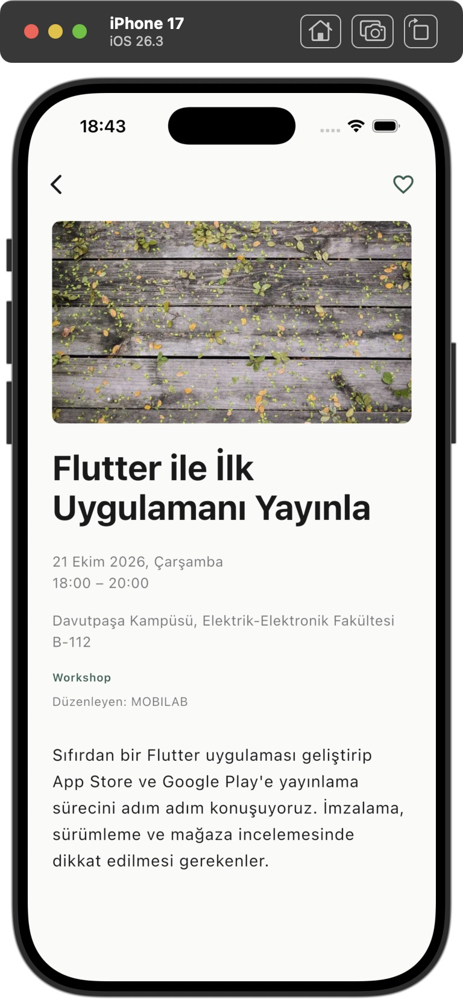
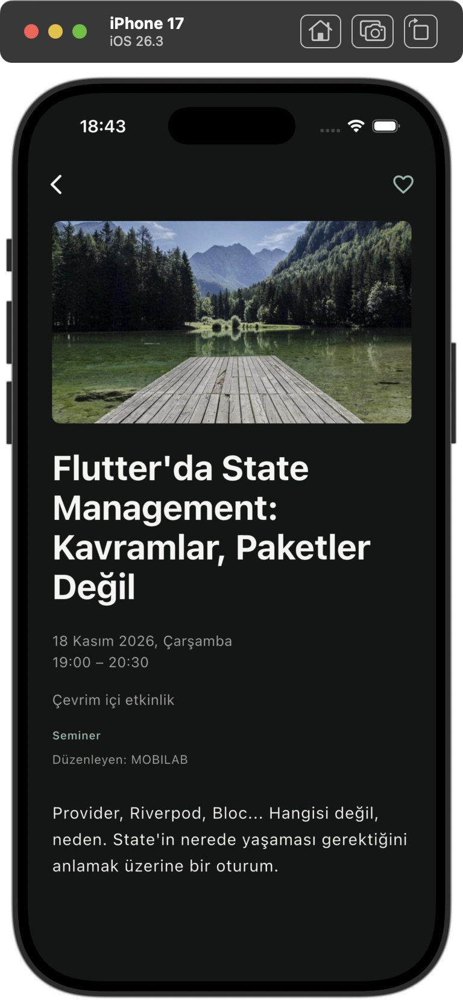

# MOBILAB — Aşama 3 sonuç raporu

> **Tarihî aşama kaydı:** Bu rapor kurtarma klonu oluşturulmadan önceki durumu anlatır. Kullanıcı daha sonra projeyi ayrı `Etkinlikler-git-kurtarma` klonuna aktardı. Güncel Git, test ve teslim durumu [README](../../../README.md) içindedir.

24 Ekim 2026. Mevcut proje geliştirildi; yeni Flutter projesi oluşturulmadı. Aşama 4'e geçilmedi.

Uygulama geliştirmesi ve otomatik doğrulamalar tamamlandı. Gerçek OTP/session/RLS kabul testleri kullanıcıyla yapılmalı. Son Git kontrolü, başlangıçta okunabilen `.git` klasörü artık bulunamadığından tamamlanamadı.

## 1. Oluşturulan dosyalar

Üretim kodu:

- `lib/core/config/otp_config.dart`
- `lib/features/onboarding/data/onboarding_repository.dart`
- `lib/features/onboarding/controllers/onboarding_controller.dart`
- `lib/features/onboarding/presentation/onboarding_gate.dart`
- `lib/features/events/controllers/event_detail_controller.dart`
- `lib/features/events/presentation/screens/event_detail_screen.dart`
- `lib/features/events/presentation/widgets/event_image.dart`

Test ve fixture:

- `test/otp_length_test.dart`
- `test/onboarding_test.dart`
- `test/event_detail_test.dart`
- `test/event_detail_widget_test.dart`
- `test/helpers/onboarding_fake.dart`
- `test/helpers/detail_fixture.dart`
- `test/fixtures/event_detail.json` — gerçek, herkese açık API yanıtı; üretimde kullanılmaz.

Rapor: bu dosya ve aşağıdaki altı PNG.

## 2. Değiştirilen dosyalar

- `lib/main.dart` — gerçek onboarding repository bağlantısı.
- `lib/app/app.dart` — onboarding kapısı, ortak controller'larla detay rotası ve kaynak bazlı Hero tag.
- `lib/features/auth/controllers/auth_controller.dart` — merkezi OTP doğrulama; String aynen iletilir.
- `lib/features/auth/presentation/screens/auth_screen.dart` — dinamik uzunluk/metin, kırpmayan input, spam açıklaması.
- `lib/core/network/api_client.dart` — 404 mesajı.
- `lib/features/events/data/events_repository.dart` — gerçek detay endpointi ve yanıt kontrolü.
- `lib/features/events/models/event.dart` — nullable description.
- `lib/features/events/presentation/widgets/event_row.dart` — satır navigasyonu, bağımsız kalp, ortak EventImage.
- `lib/features/favorites/data/favorites_repository.dart` — DELETE sonucunun SELECT ile doğrulanması.
- `lib/features/favorites/presentation/favorites_screen.dart` — aynı detay rotasına geçiş.
- `config/supabase.example.json` — OTP_LENGTH örneği.
- `pubspec.yaml`, `pubspec.lock` — mevcut shared_preferences paketinin doğrudan bağımlılık yapılması.
- `test/helpers/account_fakes.dart`, `test/helpers/fixtures.dart`, `test/supabase_repositories_test.dart` — yeni repository sözleşmesi ve OTP/DELETE test desteği.
- `README.md` — Aşama 3, çalıştırma, testler, güvenlik ve manuel kabul adımları.

Bu liste çalışma sırasında yapılan düzenlemelere dayanır. `.git` eksikliği nedeniyle nihai Git diff'iyle karşılaştırılamadı. Yerel Supabase config değerleri değiştirilmedi; `.gitignore` kuralları korundu.

## 3. OTP uzunluğu düzeltmesi

`OtpConfig`, `int.fromEnvironment('OTP_LENGTH', defaultValue: 6)` okur; yalnızca 6 ve 8 destekler. Controller, input etiketi ve açıklama aynı değeri kullanır. Sekiz haneli yapıştırma ilk altı haneye kesilmez. Altı ayarında sekiz hane açık uzunluk hatası üretir; sekiz ayarında tamamı gönderilir. Baştaki sıfırlar korunur; int dönüşümü veya trim yoktur. Numeric keyboard, yapıştırma ve autofill korunmuştur.

Yerel dosyada şu anda OTP_LENGTH 6. Dashboard'daki Email OTP Length ile eşleşmeli. Sunucu henüz 8 ise yerel JSON'da OTP_LENGTH 8 kullanılabilir; ardından uygulama tamamen durdurulup yeniden derlenmelidir. Gerçek secret değerlerini komut satırına yazmayın.

Session dönmeden giriş başarılı sayılmaz. OTP/token loglanmaz. Spam açıklaması ikincil stil kullanır. SMTP sender/domain sorunu için Flutter'da geçici çözüm uygulanmadı.

## 4. Onboarding kalıcılığı

İki sayfa istenen metinlerle hazırlanmıştır. “Şimdilik geç” ve “Keşfetmeye başla”, `SharedPreferencesAsync` üzerinden yalnızca `onboarding_completed_v1=true` yazar. Başarılı kayıttan sonra Keşfet açılır. Yazma hatasında hata ve tekrar deneme sunulur. Supabase session anahtarlarına dokunulmaz.

İlk açılış, geçme, tamamlama, ikinci açılış, mevcut auth kullanıcı durumunun korunması ve depolama hataları test edildi. Simulator'da tam durdurma/yeniden çalıştırma sonrasında onboarding gösterilmedi.

## 5. Detay endpointi

`GET https://mobilab-task-api.vercel.app/events/{event_id}` gerçek endpointine bağlandı. ID String kalır ve URL segmenti güvenli kodlanır. Yanıttaki ID eşleşmesi kontrol edilir. `evt-001` canlı yanıtında description, organizer, category, saat dilimli startDate/endDate, location, isOnline ve imageUrl incelendi.

Keşfet'teki mevcut Event, yükleme sırasında temel içerik için kullanılır; gerçek detay her açılışta istenir. Favoriler'deki özetten sahte Event üretilmez. Eksik veri uydurulmaz. Açıklama tam, seçilebilir, çalıştırılmayan metindir. API'de görülmeyen bilet/fiyat/katılım kontrolü eklenmedi.

20 saniye timeout, 404 için ayrı mesaj, sunucu/bağlantı/geçersiz yanıt, tekrar deneme ve dispose güvenliği vardır. Null/bozuk görselde sade placeholder kullanılır. Genel hatada bilinen içerik korunur; 404'te eski içerik kaldırılır.

## 6. Detay/favori senkronizasyonu

Keşfet, Favoriler ve detay tek FavoritesController kullanır. Detay kalbi ayrı state veya yeni API reload'u üretmez. Satır kalbi detay navigasyonunu tetiklemez. Girişsiz kalp mevcut auth rotasını açar; kapatınca aynı etkinlik görünür. Geri dönüş liste/sekme/scroll'u korur.

Favori silme sonrası aynı kullanıcı ve etkinlik filtreleriyle SELECT yapılır. RLS nedeniyle etkisiz kalan DELETE, sahte başarı olarak gösterilmez. Hesap değişimi ve gecikmiş yanıt ayrımı önceki yapıda korunmuştur. Canlı Supabase kalıcılığı/RLS hesabı kullanılarak doğrulanmadı.

## 7. Tasarım kararları

Mevcut tipografi, renkler ve 8px boşluk sistemi korundu. Onboarding kırık beyaz/koyu zemin, yeşil vurgu ve iki kısa metin sayfasından oluşur. Detayda 16:9 fotoğraf, güçlü başlık ve hiyerarşik bilgi sırası vardır. Fotoğraf tüm ekranı kaplamaz. Gereksiz bölüm/işlevsiz buton eklenmedi.

Görsel geçişi 220ms / 180ms Hero'dur. Tag kaynak sekme ve etkinlik ID'sini içerir. Null görsel ve reduced motion/accessible navigation durumunda kapalıdır. Ek bounce/fade/dekoratif animasyon yoktur.

## 8. flutter analyze

Başarılı: **No issues found.** Flutter 3.47.7 / Dart 3.13.5. `flutter pub get` başarılı. Güncel sürüm bildirimleri dışında bağımlılık hatası yok.

## 9. flutter test

**110 test başarılı.** Önceki 73 test korundu, 37 eklendi. Son tam koşu: `00:03 +110: All tests passed!`

Testler fake repository / MockClient kullanır; internet veya canlı Supabase'e bağımlı değildir. Yeni kapsam OTP 6/8, sıfır ve kesilmeden iletim; onboarding tüm temel yollar ve depolama hatası; detay endpointi/UTF-8/ID/404/timeout/network/geçersiz yanıt/dispose/retry; null/bozuk görsel; uzun başlık/açıklama ve 320px/2x metin; liste–detay–geri/scroll; Favoriler sekmesi ve ortak state; girişten aynı detaya dönüş; Hero/reduced motion; etkisiz DELETE kontrolüdür.

Bu sonuçlar gerçek e-posta teslimi, gerçek Supabase session restore veya canlı RLS test edildi anlamına gelmez.

## 10. iPhone 17 Simulator

Xcode 26.3, iOS 26.3, iPhone 17. Ana Desktop kopyasında framework codesign sorunu nedeniyle aynı kaynaklar, `.git` ve derleme önbellekleri alınmadan `/private/tmp/mobilab-ios-validation` konumuna kopyalandı. Kaynak proje taşınmadı ve yeniden oluşturulmadı. Geçici doğrulama kopyasında şu komut başarılı derlendi ve açıldı:

```sh
flutter run -d "iPhone 17" --dart-define-from-file=config/supabase.local.json
```

Mevcut gerçek yerel bağlantı değerleri kullanıldı; değerler çıktıya yazılmadı.

| Kontrol | Sonuç |
| --- | --- |
| İlk onboarding ve iki sayfa geçişi | Görüldü; tamamlandı |
| Tam durdurup yeniden açma | Onboarding tekrarlanmadı, Keşfet açıldı |
| Gerçek liste ve görseller | Görüldü |
| Gerçek detay ve tam API açıklaması | Görüldü |
| API hatası ve tekrar deneme | Liste ve detayda geçici hata görüldü; manuel tekrar deneme başarılı |
| Geri navigasyonu / mevcut listeye dönüş | Çalıştı; aynı liste bölgesine dönüldü |
| Kalpten auth ve auth'tan aynı detay | Çalıştı |
| Açık / koyu tema | İncelendi; taşma veya tutarsız padding görülmedi |
| E-posta alanı + yazılım klavyesi | İncelendi; buton erişilebilir, taşma yok |
| OTP sayfası + native sayısal klavye | Gerçek kod gönderilmediği için manuel bekliyor; widget testinde kapsanır |
| Çok uzun açıklamanın native kaydırılması | Kullanılan gerçek açıklamalar ekrana sığdı; otomasyon scroll komutu araç hatası verdi. Uzun içerik/kaydırma küçük ekran widget testinde geçer; native manuel kontrol bekliyor |
| Gerçek giriş ve kayıtlı Favoriler'den detay | Kullanıcı hesabı/OTP olmadan denenmedi; fake integration testleri geçer |

Ekran görüntüleri yalnızca onboarding, kamuya açık etkinlik verisi ve boş giriş ekranı içerir:

[01 — İlk onboarding](01-onboarding.png) · [02 — İkinci sayfa](02-onboarding.png) · [03 — Açık detay](03-detay.png) · [04 — Koyu detay](04-detay-koyu.png) · [05 — Giriş/klavye](05-giris-klavye.png) · [06 — Yeniden açılış](06-yeniden-acilis-kesfet.png)





## 11. Git güvenliği

Başlangıçta `main...origin/main` ve mevcut GitHub bağlantısı okunabiliyordu. `git check-ignore -v config/supabase.local.json` ignore kuralını gösterdi; `git ls-files config/supabase.local.json` boş döndü. Yerel dosyadaki değerler değiştirilmedi.

Son kontrolde `.git` klasörü bulunamadı. Kullanıcı klasörü değiştirmediğini bildirdi. Nedeni belirlenemedi. Yakındaki olası konumlarda bulunmadı; yeni Git deposu başlatılmadı, geçmiş restore/reset/yeniden yazım yapılmadı. Üç istenen son kontrol de exit 128 ile `fatal: not a git repository` döndü:

```sh
git status --short
git check-ignore -v config/supabase.local.json
git ls-files config/supabase.local.json
```

Dolayısıyla son tracked/staged/geçmiş denetimi **tamamlanamadı**. Bu konu Git metadata'sı güvenli biçimde kurtarıldıktan sonra tekrar kontrol edilmeli. `.gitignore` dosyasında yerel config ve secret kuralları yerinde. 157 kaynak/ayar/belge dosyasında yerel gerçek bağlantı değerleri ve yaygın secret biçimleri değerler basılmadan tarandı; olası eşleşme bulunmadı. Bu tarama bütün secret türlerini veya eksik Git geçmişini doğrulayamaz.

Commit, push, Git klasörü silme, git init, reset veya geçmiş değiştirme komutu çalıştırılmadı. Resend/server anahtarı eklenmedi. Fixture'larda yalnızca sentetik auth değerleri ve herkese açık API verisi kullanılır.

## 12. Tamamlanmayan manuel işler

- Dashboard Email OTP Length ile yerel OTP_LENGTH ayarını eşleştirme.
- Gerçek e-posta teslimi/spam, doğru/yanlış/süresi dolmuş OTP, resend/rate limit.
- Gerçek session'ın uygulama yeniden açılışında dönmesi ve çıkışta temizlenmesi.
- Gerçek Supabase favorilerinin yeniden açılış ve hesap A/B ayrımı; canlı RLS SELECT/INSERT/DELETE ve anon yasakları.
- Resend sender/domain kısıtlamaları gerekiyorsa servis tarafında çözülmeli.
- OTP sayfasında native klavye ve çok uzun gerçek açıklamada native scroll kontrolü.
- Eksik Git metadata'sının güvenli kurtarılması ve son üç Git komutunun tekrarı.
- Android SDK olmadığı için Android; fiziksel iPhone testi yapılmadı.

## 13. Kullanıcının test adımları

1. Önce eksik `.git` konusunu çözün; ignore/tracked kontrolleri geçmeden secret dosyaları içeren toplu `git add` yapmayın. Yeni Git geçmişiyle mevcut geçmişin üzerine yazmayın.
2. Dashboard Email OTP Length 6 ise yerel OTP_LENGTH 6 kalsın. Sunucu hâlâ 8 ise yerel dosyada 8 seçin. Config değerlerini paylaşmadan uygulamayı tamamen durdurup yukarıdaki komutla çalıştırın. Desktop codesign sorunu olursa README'deki geçici kopya adımlarını kullanın.
3. Onboarding tamamlanmış mevcut kurulumda doğrudan Keşfet açılmalı. İlk açılış/geçme için auth verisi olmayan ayrı, temiz bir test kurulumu kullanın; mevcut session depolamasını topluca temizlemeyin.
4. Listeyi aşağı kaydırın, satırdan detaya girin ve geri dönün. Aynı konum ve sekme korunmalı. Satırdaki kalp yalnızca auth/favori davranışını tetiklemeli.
5. Açık/koyu tema, görsel, uzun başlık/açıklama, Türkçe tarih ve çevrim içi bilgisini inceleyin. Hata varsa “Tekrar dene”yi deneyin.
6. Detay kalbinden giriş açın; kapatınca aynı detay kalmalı. İzinli kendi adresinize kod isteyin. Inbox/spam teslimi, 6/8 hane, baştaki sıfır, yanlış uzunluk ve doğru kodu deneyin. Sekiz hane altı ayarında kesilmemeli. OTP'yi/logu rapora koymayın.
7. Giriş sonrası Keşfet/detaydan ekleyin; Favoriler satırından aynı detaya girip kaldırın. Kalpler ve liste birlikte değişmeli; hızlı çift basma mükerrer kayıt üretmemeli.
8. Birkaç favoriyle uygulamayı tamamen kapatıp açın; session ve kayıtlar dönmeli. Çıkıp B hesabına girin; A kayıtları görünmemeli. A'ya dönünce kendi kayıtları gelmeli.
9. Offline veya Supabase reddi sırasında sahte başarı olmamalı. Bağlantı sonrası listeyi yenileyin. README'deki canlı RLS test listesini normal kullanıcı session'larıyla uygulayın; service-role kullanmayın.

AI kullanım notu: Codex mevcut mimari/paket kaynaklarını ve gerçek API yanıtını inceledi, bu aşamanın kodunu/testlerini geliştirdi, analiz ve testleri çalıştırdı, Simulator görüntülerini inceleyip bu raporu hazırladı. Dashboard/SMTP/RLS ayarlarını değiştirmedi; gerçek kullanıcı testlerini yapılmış göstermedi. Bu aşamada duruldu.
