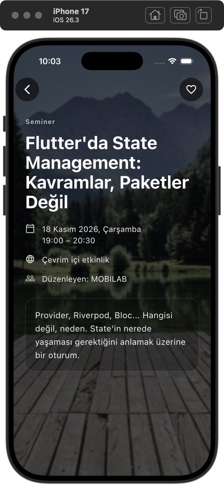
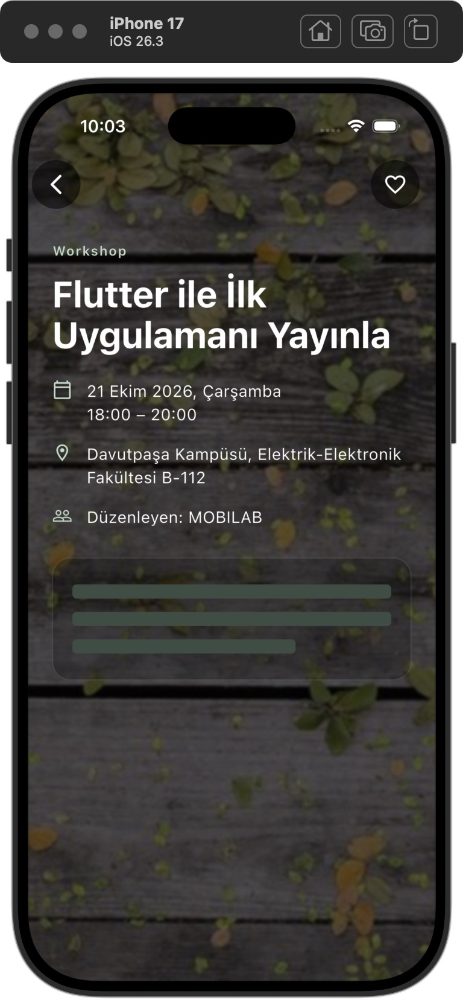

# UI ve ücretsiz teslim akışı — 25 Ekim 2026

Bu kayıt, 220 testlik [final audit](../final-audit/rapor.md) sonrasındaki kullanıcı isteklerini kapsar. Önceki rapor tarihî denetim kanıtıdır; aşağıdaki değişiklikler onun üstüne uygulanmıştır. Commit/push/canlı deploy yapılmadı.

## Değişiklikler

- Alt nav zemini ve surface tint şeffaf; dolu yüzey gibi görünen gölge kaldırıldı. İnce çerçeve, ikonlar, SafeArea, klavyede gizlenme ve sekme state’i korundu.
- Detay blur’u landscape 5→1.3, square 3→0.8, portrait 1→0.4; siyah scrim alpha 184/255→163/255. Fotoğraf daha belirgin ve daha az bulanık. Ayrı foreground fotoğraf eklenmedi; gerçek API yüzeyi/BoxFit.cover/listener/cache sınırları korundu.
- Beyaz, mint `#C4DFC8` ve %85 beyaz metin en parlak beyaz kaynak üzerinde >=4.5:1 kontrastla test edildi. Açıklama panelinin dekorasyonu ve 20px padding’i ortak `DetailTextSurface` üzerinden kullanılır. Fotoğrafı eksik/bozuk kayıtlar ikonsuz nötr fallback’i korur.
- Açıklama skeleton’ı aynı panelin 20px içindeki metin genişliğini ve 17px/1.6 fontun gerçek TextPainter satır yüksekliğini kullanır. Erişilebilir yazı ölçeğine uyar. İlk iki satır tam genişlik, son satır %70’tir. Henüz alınmamış açıklamanın gerçek satır sayısı ve son satır genişliği önceden bilinemez. Cached metin gizlenmez.
- `bash tool/run.sh -d "iPhone 17"` yerel config’i otomatik geçirir. Dosyayı kopyalamaz/değiştirmez, yoksa girişsiz inceleme çalışır. Elle verilmiş başka config ve boşluklu yollar doğrulandı. Kurulu uygulamanın normal yeniden açılması zaten terminal komutu gerektirmez; dart-define yeni derlemeye aittir.
- Eksik hesap yapılandırması UI’da terminal/JSON komutu yerine anlaşılır bir mesaj ve Keşfet’e dönüş kontrolü gösterir. Teknik config doğrulaması controller/config tarafında korunur; auth bypass yoktur.
- `tool/build_web.py` URL/publishable key/OTP length’i doğrular; secret/server anahtarını ve yarım config’i reddeder. Ortam veya yerel ignored dosya kullanır; değerleri loglamaz. Geçici config sonunda temizlenir. Renderer dosyaları kendi web build’inde paketlenir.
- Opt-in `.github/workflows/flutter_pages.yml`: public main, standart Ubuntu, pub get/analyze/test → release build → Pages. Pages ve id-token yazma yetkisi yalnızca deploy job’ında; credentials persist edilmez, artifact 1 gün, timeout sınırlı, cache kapalı. Fork PR’dan veya private repodan deploy yok. `PAGES_ENABLED=true` ya da main’den manuel çalıştırma gerekir.
- README inceleyici için hızlı başlangıçla yeniden düzenlendi. Gerçek kurulum gereksinimleri, config’in nedeni, yerel/online farkı, ücretsiz plan ve OTP engeli, yayın adımları ve AI kullanımı açıklandı. [Sahibin yapacağı tek seferlik ayarlar](../../teslim.md).

## Doğrulama

| Kontrol | Sonuç |
|---|---|
| `flutter analyze` | Temiz |
| `flutter test` | **223/223 PASS** |
| Yeni `detail_readability_test.dart` | Beyaz/mint kontrastı + 1.0x/1.8x skeleton/paragraf genişlik ve satır geometrisi: **3 PASS** |
| Mevcut auth widget testi | Configsiz güvenli ekran, dev komutlarını gizleme, disabled gönderme ve Keşfet’e dönüş başarılı |
| Native kısa çalıştırma komutu | Yerel config otomatik kullanılarak iPhone17/iOS26.3 normal build/launch başarılı |
| Configli `tool/build_web.py --base-href /Etkinlikler/` | Release build başarılı; gerçek browser araması ve API fotoğraflı detay açıldı |
| Configsiz aynı base path web release | Build başarılı; tarayıcıda Keşfet ve kontrollü hesap ekranı açıldı |
| `run.sh` doğrulaması | Config yok/yerel/elle verilmiş config, boşluklu path/cihaz adı, dosyanın korunması başarılı |
| Web config denetimi | Sentetik ayarlarla 9 durum: boş/geçerli/eksik/secret/HTTP/query URL/geçersiz OTP/ortam önceliği doğrulandı |
| Workflow YAML + `bash -n tool/run.sh` | Geçerli |
| Canlı GitHub Pages deploy | **Yapılmadı**; kaynaklar henüz yerel |
| Farklı adrese canlı OTP / iki hesaplı RLS | **Tamamlanmadı**; manuel kabul gerekli |

İlk UI değişiklikleri sonrası 49 ilgili regresyon testi de geçti. Auth ekranındaki küçük metin/dönüş iyileştirmesinden sonra tam analiz ve 223 test yeniden çalıştırıldı. Testlerin başarılı olması SMTP teslimi, canlı RLS veya online deploy başarısı gibi sunulmaz.

## Ekran kanıtları

| Gerçek normal iPhone detayı | Debug gecikmeli açıklama skeleton’ı |
|---|---|
|  |  |

[Şeffaf native nav](02-iphone-transparent-nav.png) · [Gerçek web release detayı](01-web-detail.png) · [Configsiz hesap ekranı](05-web-account-unconfigured.png)

Skeleton görüntüsü mevcut `tool/skeleton_preview.dart`, `PREVIEW_DELAY_MS=12000` ile alındı. Gerçek public API verisine yapay debug gecikmesi uygular; auth/favoriler bellekte taklittir, e-posta göndermez veya Supabase/kullanıcı tercihlerini değiştirmez. Bu görsel canlı favori kabulü değildir. Kontrol sonunda normal `lib/main.dart` uygulaması geri yüklendi.

Web release `127.0.0.1` üzerinde gerçek `/Etkinlikler/` yolu ile açıldı. Intro/onboarding, gerçek API liste fotoğrafları, State araması, detay, geri ve configsiz hesap ekranı gözlendi. Yerel HTTP sunucusu yalnızca 127.0.0.1 dinler; bu bir public deploy değildir. Normal native sürüm son açılışta gerçek API 500 hatası gösterdi; kullanıcı kontrollü liste/kategori retry işlemleriyle toparlandı. Bu sunucu hatası gizlenmedi. Web ve native depoları/oturumları ayrıdır. Fotoğrafın CORS nedeniyle yüklenmediği bir bulgu oluşmadı; bu bütün tarayıcılar için garanti değildir.

## Ücret ve OTP konusunda gerçek durum

Açık Dashboard oturumlarından yalnızca okuma yapıldı:

- Supabase organizasyonu **Free**, Free plan kullanım kotaları görünür. Spend Cap Pro’ya aittir; Free kullanımı ücretlendirilmez. Pro’ya geçilmedi veya ücretli eklenti açılmadı.
- Resend Transactional **Free**, kota **3.000/ay ve100/gün**. Pay-as-you-go anahtarları kapalı/devre dışı. Ücretli yükseltme yapılmadı.
- Supabase custom SMTP host’u `smtp.resend.com`. Resend Domains: **No domains yet**. Bu, test göndericisinin değerlendiricinin farklı adresine teslim engelini çözmez.

Kullanıcı alan adı olmadığını ve ücretsiz seçenek istediğini belirtti. Yeni alan adı veya plan alınmadı. Uygulama şifresi oluşturulabilen mevcut kişisel Gmail hesabı için düşük hacimli SMTP adımları rehbere yazıldı. **Şifreyi hesap sahibinin oluşturup Supabase’e kendisinin girmesi gerekir**; bu çalışma credential oluşturmadı/değiştirmedi. Gerçek farklı alıcıyla kabul yapılmadığından yeni kullanıcı OTP/favori akışına PASS verilmez. Varsayılan Supabase mail servisine dönmek de herkese teslim sağlamaz.

Ücretsiz planlar kota veya etkinlik nedeniyle kısıtlanabilir/duraklatılabilir. Otomatik ücretli upgrade, ücretli keep-alive servisi veya kart ekleme yapılmadı. İstemci request guard’ı finansal hard cap değildir. Kaynaklar ve güncel servis açıklamaları [teslim rehberindedir](../../teslim.md).

## Kalan somut adımlar

1. Hesap sahibi mevcut uygun Gmail hesabından uygulama şifresini kendisi oluşturup yalnızca Supabase SMTP ayarına girer; düşük gönderim sınırı ve gerçek farklı alıcı testi tamamlanır. Şifreyi sohbet/Git’e yazmaz. Eğer hesap uygulama şifresi sunmuyorsa bu seçenek tamamlanmış sayılmaz.
2. İki yetkili hesapla gerçek RLS A/B izolasyonu kabul edilir; şema/policy otomatik değiştirilmedi.
3. Kullanıcı güncel kaynakları yayımlar, repo Pages/Variables ayarlarını bir kez tamamlar, Flutter Web Pages workflow’unu main’den çalıştırır; başarılı URL’yi ödeve ekler.

**Sonuç:** UI, yerel test ve build’ler hazır. Girişsiz inceleme çalışıyor. Tam hesaplı teslim, SMTP/RLS ve gerçek online yayın kabulü bitmeden koşulsuz hazır değildir. Mevcut Git geçmişi, yerel config ve kullanıcı favorileri korunur.
