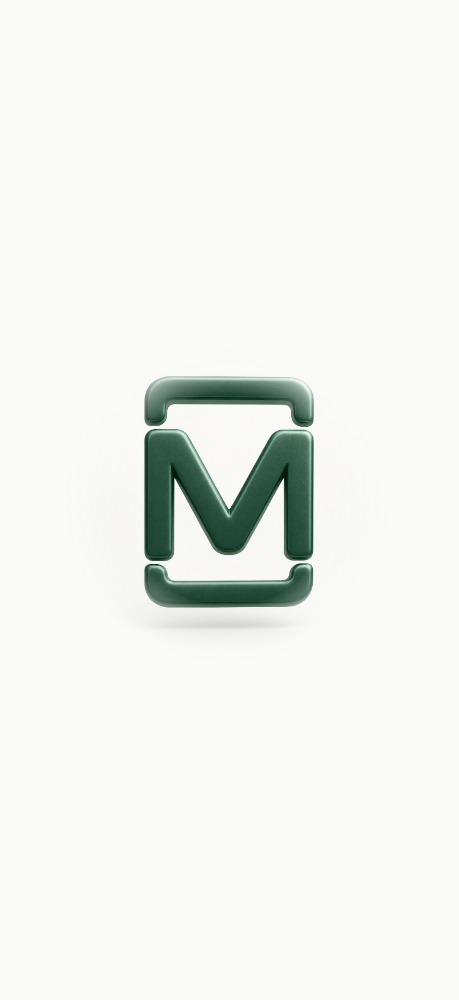
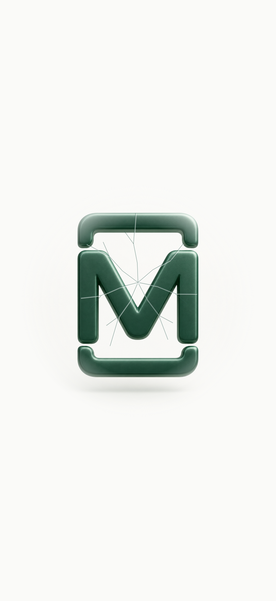
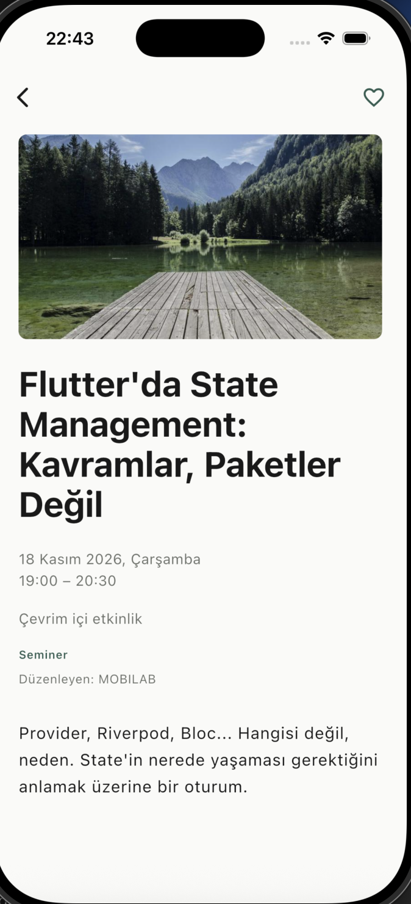

# MOBILAB — Final motion ve polish raporu

Tarih: 24–25 Ekim 2026. Flutter 3.47.7 stable / Dart 3.13.5, Xcode 26.3, iPhone 17 / iOS 26.3 Simulator. Çalışma klasörü: `/Users/cigdemgokdas/Desktop/Etkinlikler`.

## 1. Devralınan ilerleme ve Git durumu

Proje yeniden oluşturulmadı. `pwd`, `git status`, diff/stat ve geçmiş kontrolüyle güncel kaynakların orijinal **Etkinlikler** Git çalışma ağacında olduğu doğrulandı. Branch `main`; HEAD `3f9178f — mobilab etkinlikler mvp`. Kurtarma klonuyla karıştırılmadı. Geçmiş, mevcut kaynaklar, Supabase config ve oturum korunuyor. Bu motion/polish çalışmasında stage, commit veya push yapılmadı.

Önceki ilerlemede logo asset’i/intro, floating navigation, collapsing header, sliver listeleri, debug onboarding seçeneği, iki görünür fotoğraf katmanlı adaptive detay ve 23 ek test hazırdı. 203 testin geçtiği kayıt vardı. Sonraki küçük, yarım kalmış portrait crop değişikliği iki eski foreground-fit beklentisini başarısız bırakmıştı; bunlar test silmeden son tek yüzey tasarımına uyarlandı. Tek yüzeye geçiş sonrası 203 test yeniden geçti. Status bar, SafeArea, son görsel QA ve belgeler tamamlanması gereken işlerdi.

## 2. Yeni/değişen dosyalar

| Sorumluluk | Dosyalar |
| --- | --- |
| Orijinal logo | `assets/branding/mobilab_logo.png`, `pubspec.yaml` |
| Cold start / intro | `lib/main.dart`, `lib/app/launch/launch_intro.dart` |
| Native başlangıç rengi | iOS `LaunchScreen.storyboard`; Android `drawable*/launch_background.xml`, `values/colors.xml`, `values-v31/styles.xml`, `values-night-v31/styles.xml` |
| Ana navigasyon / status bar | `lib/app/app.dart`, `lib/app/widgets/floating_navigation.dart` |
| Büyük başlık ve kontroller | `lib/app/widgets/collapsing_header.dart`, `explore_screen.dart`, `favorites_screen.dart` |
| Tek yüzeyli detay | `event_detail_screen.dart`, `adaptive_event_composition.dart` |
| Eksik alan / debug onboarding | `event.dart`, `onboarding_repository.dart` |
| Yeni testler | `adaptive_composition_test.dart`, `launch_motion_test.dart`, `premium_navigation_test.dart`, `final_polish_test.dart`, `helpers/controlled_image.dart` |
| Korunan testlerin yeni widget seçicileri | `discovery_widget_test.dart`, `event_detail_widget_test.dart`, `skeleton_loading_test.dart`, `widget_test.dart` |
| Debug görsel araçları | `tool/motion_preview.dart`, `tool/capture_intro_test.dart` |
| Belgeler / kanıtlar | `README.md`, bu rapor, aynı klasördeki PNG’ler ve `intro-frames/` |

API istemcisi, event/favorite/auth repository’leri, debounce ve pagination controller’ları değiştirilmedi. Yeni paket eklenmedi.

## 3. Logo intro, impact ve fracture

Sağlanan PNG projeye birebir kopyalandı; SHA-256 karşılaştırması orijinalle aynı olduğunu doğruladı. Form, malzeme, renk ve orijinal gölge korunur. Flutter’da yumuşak radial alpha mask yalnızca dış arka plan sınırını zemine bağlar; yeni logo üretilmedi.

2.2 saniyelik `AnimationController`: küçükten hızlanan yaklaşma, hafif perspective/rotation, 1.13 scale impact ve 1.0’a sakin oturma. En fazla yaklaşık 2 logical pixel sarsıntı vardır; bounce, ses, konfeti veya parçacık yoktur. `ImpactCrackPainter` yedi ince ana hat, kısa dallar ve ışık/gölge ayrımı çizer; hatlar çözülürken alttaki ekran ortaya çıkar. RepaintBoundary ve AnimatedBuilder child ayrımı logoyu her tick’te yeniden kurmayı önler.

`LaunchIntro`, Navigator’ın üstünde yaşar. Yeni süreç/root state intro’yu tekrar oluşturur; sekme, route, hot reload veya lifecycle resume başlatmaz. Controller dispose edilir. Reduced motion / accessible navigation ile perspective, sarsıntı ve fracture kaldırılır; 360ms logo fade kalır. Supabase başlangıcı paralel Future’dır; intro süresi servis yanıtına bağlı değildir. Native launch rengi aynı `#FAFAF8` tonudur.

Canlı simülatörde cold start logo ve impact/fracture görüldü. Kontrollü widget render kareleri `intro-frames/400-ms.png`, `1050-ms.png`, `1320-ms.png`, `1580-ms.png` olarak ayrıca incelendi. Bu kareler simülatör screenshot’u olarak sunulmuyor. Yerel kısa video da alındı; rapora kare dizisi dahil edildi. Fiziksel cihaz FPS/GPU profili ölçülmedi.

| Yaklaşma | Impact / ince çatlak |
| --- | --- |
|  |  |

## 4. Onboarding

İlk kullanım akışı Intro → 1 → 2 → Keşfet olarak gözlendi. Kayıtlı tamamlanma anahtarı `onboarding_completed_v1` korundu. Sonraki normal cold start’ta intro sonrası Keşfet açıldı; oturum açık kaldı.

`kDebugMode && bool.fromEnvironment('FORCE_ONBOARDING')` yalnızca debug’da bellekte `PreviewOnboardingRepository` seçer. Gerçek tercihi okumaz/yazmaz, Supabase oturumunu silmez. Release’te aktif olmaz. `03-onboarding-1.png` ve `04-onboarding-2.png` aynı çalışmanın debug ilk kullanım gözlemleridir; final durum çubuğu düzeltmesinden önce alınmış tarihî karelerdir. Onboarding/auth/intro status bar davranışının son hali ayrıca render stili testleriyle doğrulandı.

## 5. Floating navigation ve header collapse

NavigationBar 24px yatay margin, 24px radius, çok hafif gölge, nötr surface, SafeArea ve 68px içerik yüksekliği kullanır. Scaffold bar için yer ayırır; son satırın üstüne binmez. Klavye viewInset’i varsa gizlenir. Outline/filled kalp korunur. `IndexedStack` liste, filtre ve scroll’u saklar.

Pinned `SliverPersistentHeader` yalnızca fontu değil yüksekliği ve başlık konumunu değiştirir. Büyük başlık 34px’ten kompakt 20px’e geçer; erişilebilirlik ölçeği için geniş başlık yüksekliği ayarlanır. Arama/kategori sliver’ı sıfır minExtent’e kadar kapanır. Aynı child/focus korunarak .35 oranlı translate ve clip ile kontroller daha yavaş yükselir. Ters scroll geniş düzeni geri getirir.

Canlı simülatörde klavye PageDown/PageUp kaydırmalarıyla compact başlık, arama/kategorilerin gizlenmesi ve ters scroll gözlendi. Native sürükleme otomasyonunun ilk denemeleri etkisizdi; bu rapor bunları başarılı parmak hareketi testi olarak saymaz. %69/%70 kesin sınırı widget testlerinde ölçülür; canlı API’nin ikinci sayfasındaki Figma ve sonraki kayıtlar simülatörde görüldü.

## 6. Tek yüzeyli adaptive detay mimarisi

Son kullanıcı talebiyle ayrı foreground dikdörtgen fotoğraf, onun boyut alanı, kenar maskesi ve destination Hero kaldırıldı. Önceki beğenilen atmosferik katman tek ana fotoğraf yüzeyine dönüştü. Başlık ve bilgiler üst güvenli alanın altında doğrudan fotoğrafa yerleşir. Açıklama tek, sınırlı transparan yüzeydedir. Kısa içerikte ekran fotoğrafla devam eder; uzun içerik tek dikey scroll ile okunur.

### Görsel oranları ve kompozisyon

Aynı ImageStream’in decode ettiği gerçek width/height oranı kullanılır: ≥1.3 landscape, <0.85 portrait, arası square. Dosya adından oran tahmini, ek HEAD/HTTP metadata isteği veya focal point varsayımı yoktur.

Her modda tek `RawImage` ve orantılı `BoxFit.cover` vardır. Ek zoom yapılmaz. Landscape’te önceki sigma 5 atmosfer korunur; square sigma 3, portrait sigma 1 kullanır. 16:9 kaynağın uzun dikey viewport’ta sağ/sol crop’u bilinçli tasarım kararıdır; son talep bu kaybı atmosferik bütünlük için kabul eder. Fotoğraf esnetilmez ve ayrı kopyası tekrar gösterilmez. Portre/karede de foreground kart yoktur.

### Image metadata, cache ve kaynak ömrü

NetworkImage → ResizeImage (fit, en fazla 1200×1600, allowUpscaling false) → tek ImageStream → tek ImageInfo/RawImage. Flutter ImageCache korunur. Düşük çözünürlüklü görsel devasa decode edilmez; iki görünür fotoğraf için çift istek yoktur.

URL/provider değişiminde listener çıkarılır, generation artırılır, eski frame sonraki render sonrasında dispose edilir. Geç gelen eski görsel yeni etkinliğin oranını ezemez. Widget dispose’unda listener/frame temizlenir. Sabit arka plan RepaintBoundary içindedir; blur scroll tick’lerine bağlı yeniden üretilmez.

### API veri akışı

Liste snapshot’ı ilk çizimi hızlandırır; her detay açılışında mevcut repository `GET /events/{id}` çağırır. Güncel yanıt esas alınır; yeni URL yeniden resolve edilir. Favori event ID ile eşleşir ve ortak FavoritesController üzerinden güncellenir.

Canlı `evt-011` yanıtı ayrıca doğrulandı: gerçek göl fotoğrafı `https://picsum.photos/seed/evt011/800/450`, gerçek başlık/açıklama, `startDate`, `endDate`, online konum, Seminer ve MOBILAB. API alanı `startsAt` değil `startDate`’tir. Eksik organizer boş kalır ve UI’da gizlenir; fiyat/bilet üretilmez. API geçici 500 yanıtları verdi; retry ile canlı içerik tekrar alındı.

### Kontrast, uzun içerik ve durumlar

Önceki 0xB8 siyah scrim korunur. En parlak beyaz fotoğraf üstünde dahi beyaz metin kontrastı ≥4.5:1 test edildi. Büyük başlıklar wrap eder; açıklama SelectableText ve sınırsız satırdır. 320×568 ve 2× yazıda üç oran için son açıklama satırına kaydırma testi vardır. Back/kalp üstte sabit, alt padding home indicator’a uygundur.

Canlı görsel kontrolde Scaffold’ın body MediaQuery’sinin üst padding’i tüketmesi yüzünden kategori/back yakınlığı bulundu. Dış ekranın gerçek `viewPadding` değeri kompozisyona aktarılıp düzeltildi; final göl ekranında kontroller ile metin ayrışır. Null/bozuk görsel koyu nötr yüzeye geçer; gerçek bilgi kullanılabilir kalır. Skeleton, cached veride güncelleme hatası, 404, timeout ve retry mevcut controller davranışını korur.

## 7. iOS status bar ve route geçişi

MaterialApp builder ve ana ekran `AnnotatedRegion<SystemUiOverlayStyle>` ile açık temada koyu, koyu temada açık ikonlar seçer. Fotoğraf detay AppBar’ı `SystemUiOverlayStyle.light` ister. Intro açık zemini için koyu ikonları kendi annotation’ıyla belirler. Global imperative stil değişikliği yoktur; route pop ile alttaki annotation yeniden görünür.

Son testler gerçek render’ın `SystemChrome.latestStyle.statusBarBrightness` değerini açık/koyu keşfet → detay → geri → auth → geri akışlarında ölçer. Intro üstteyken/alttaki koyu route açığa çıkınca doğru stil de ölçülür. Canlı açık/koyu geri dönüşler kaydedildi.

Detaya geçiş 220ms fade, geri 180ms fade. Liste Hero’larının kaynak/ID tag’leri benzersiz kalır; full-screen atmospheric crop için destination Hero zorlanmaz. Reduced motion’da süre sıfırdır. Yeni ekranda stretch veya iki fotoğrafın çarpışması gözlenmedi.

## 8. Test sonuçları

Son çalıştırılan zorunlu kontroller:

| Komut | Sonuç |
| --- | --- |
| `flutter pub get` | Başarılı; yeni dependency yok |
| `flutter analyze` | **No issues found** |
| `flutter test` | **209/209 başarılı** |
| `git diff --check` | Temiz |
| iPhone 17 debug build / launch | Başarılı |

180 başlangıç testi ve 23 motion testi korundu. Son polish için 6 test eklendi: iki tema status bar/auth dönüşü, intro annotation geri yüklemesi, üç görsel oranında küçük ekran/büyük metin/tam scroll. Mevcut görsel testleri tek yüzey kararına göre güncellendi; hiçbir test silinmedi. 16:9, 4:3, 1:1, 3:4, 9:16 ve 16×9 düşük çözünürlükte gerçek decode metadata, tek RawImage, tek provider load ve orantılı crop ölçülür. Async eski kaynak, null/geçersiz URL ve görsel hata durumları kontrollü ImageStreamCompleter ile internetsiz çalışır.

Kontrollü intro kare export’u ayrıca `flutter test tool/capture_intro_test.dart --dart-define=CAPTURE_INTRO=true` ile başarılı çalıştırıldı; bu yardımcı export testi yukarıdaki 209’a dahil değildir.

## 9. iPhone 17 gözlemleri ve kanıtlar

| Kanıt | Gözlem |
| --- | --- |
| `00-before-user-reference.png` | Kullanıcının verdiği eski beyaz detay ekranı; bu çalışmada çekilmedi |
| `01-live-landscape.png` | Önceki iki katmanlı sürüm; foreground kaldırılmadan önceki karşılaştırma |
| `02-explore-expanded.png` | Önceki geniş başlık görünümü; final status bar kanıtı değildir |
| `03-onboarding-1.png`, `04-onboarding-2.png` | Debug FORCE_ONBOARDING, intro sonrası ilk kullanımın iki sayfası |
| `05-single-surface-live.png` | **Son tek yüzeyli gerçek State Management / göl fotoğrafı** |
| `06-back-light-status.png` | Detaydan dönüş, koyu ikonlar, arama ve favori state’i korunmuş |
| `07-favorites-synced.png` | Detaydan eklenen gerçek etkinlik Favoriler’de; test eklemesi sonradan geri alındı |
| `08-dark-explore.png`, `09-back-dark-status.png` | Koyu tema ve detaydan dönüşte açık ikonlar |
| `10-collapsed-header.png` | Kompakt Keşfet; arama ve kategori gizli |
| `11-second-page.png` | Gerçek ikinci sayfa ve null görselli Figma kaydı |
| `12-null-image-live.png` | Gerçek null imageUrl detayında kullanılabilir nötr fallback |
| `13-square-fixture.png` | Kare tek yüzey; sentetik ölçüm görseli, canlı API fotoğrafı değil |
| `14-portrait-fixture.png` | 9:16 portre tek yüzey; aynı çevrim dışı ölçüm fixture’ı |
| `15-large-text-fixture.png` | 1.8× yazıyla uzun başlık; kesilmeden doğal akış |
| `16-final-explore.png` | Fixture’lardan sonra gerçek config ve mevcut oturumla bırakılan normal uygulama |

Simülatörün erişilebilirlik ağacı yeni ekranı bildirirken compositor bir süre eski fixture karesinde kaldı. Cihaz verisi silinmeden shutdown/boot yapıldı; normal cold start yeniden doğrulandı. Bu görüntüleme problemi kaynak dosyaları, yerel tercihleri veya auth oturumunu sıfırlamadan giderildi.

Kare/portre yönleri canlı API’de gözlenen 800×450 fotoğraflardan ayrı, `tool/motion_preview.dart` sentetik ızgara görselleriyle simülatörde kontrol edildi. Izgara kareleri esneme olmadığını görünür kılar. Bu giriş release’te çalışmaz, üretim `main.dart` tarafından import edilmez; API veya gerçek kullanıcı favorilerine yazmaz. Büyük yazılı uzun metnin başlangıcı simülatörde gözlendi; açıklamanın sonuna kadar erişim 320×568 / 2× yazı widget testinde üç oran için ölçüldü. Native son-satıra kadar parmakla kaydırma kabulü ayrıca yapılmalıdır.

### Eski ve son detay

| Eski düz sayfa — kullanıcı referansı | Son tek yüzey — canlı API |
| --- | --- |
|  |  |

## 10. Güvenlik ve kalan manuel kabul

Yerel `config/supabase.local.json` ignore edilmeye devam eder ve tracked değildir; önceki kurtarma ve iOS düzeltmesi sırasında kaydedilmiş SHA-256 ile birebir aynı kaldığı doğrulandı. Değişen/yeni 31 metin dosyasında private-key, Supabase secret, Resend key ve JWT biçimli credential taramasında bulgu yoktu; bu kalıp taraması bütün olası sırları dışlayan bir garanti değildir. Orijinal logo dışında özel asset eklenmedi. Testlerde yalnızca sentetik kimlikler/örnek alan adları kullanılır; OTP/session/refresh token veya kişisel e-posta ekran görüntülerine konmaz. Kaynaklar ve Git geçmişi korunur. Commit/push yapılmadı.

Canlı simülatörde mevcut oturumla favori ekleme, ortak liste/Favoriler eşitlemesi ve silme gözlendi; QA eklemesi geri alındı. Bu tek kullanıcı kontrolü iki hesaplı RLS güvenlik kabulünün yerine geçmez. Gerçek OTP teslimi/spam, yanlış/süresi dolmuş kod, hesap A/B izolasyonu ve sunucu RLS policy kabulü ayrıca kullanıcı oturumlarıyla yapılmalıdır. Servis şeması/SMTP/policy değiştirilmedi.

Fiziksel iPhone FPS/ısı/bellek profili, gerçek parmakla gesture hissi, Android cihaz doğrulaması ve bu değişikliklerin push sonrası CI koşusu yapılmadı. Android SDK yoktur. %70 kesin eşiği testte; canlı ikinci sayfa yüklenmesi simülatörde doğrulandı. Doğrulanmayan noktalar başarılı gösterilmedi.
