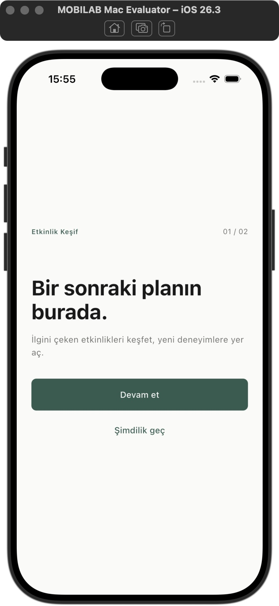
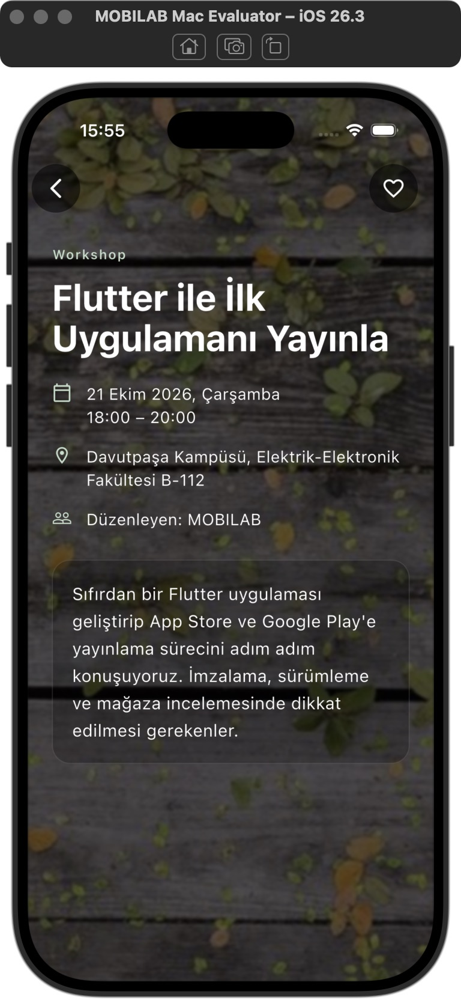
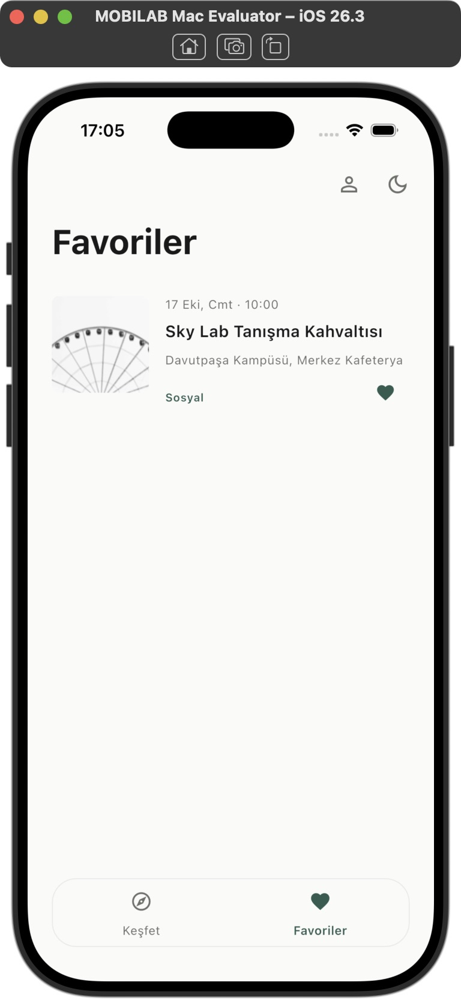
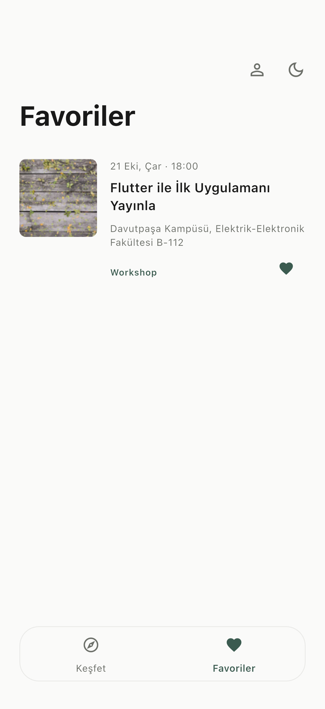
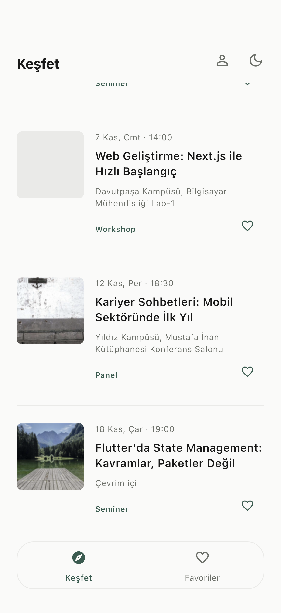

# MOBILAB — Mac değerlendirici kabul raporu

**READY FOR SUBMISSION** — Mac/iPhone Simulator için temel kabul zinciri gerçek GitHub kaynakları, gerçek Supabase ve gerçek native uygulama üzerinde doğrulandı. Aşağıda otomatik test, native integration harness ve değiştirilmemiş uygulamanın doğrudan gözlemi ayrı belirtilir; denenmeyen alt kontroller PASS sayılmaz.

## 19 kabul maddesi

| # | Madde | Durum | Somut sonuç |
|---|---|---|---|
| 1 | Gerçek GitHub clone tarihi/commit | PASS | 2026-10-25T15:53:28.220368+03:00; branch main, SHA `7af3d6fd37b605582f929e2d75fd6e745d809ec6`. Başlangıç ve son `ls-remote` aynı SHA. |
| 2 | Temiz clone klasörü | PASS | `/private/tmp/mobilab-mac-evaluator-2csu8yac/Etkinlikler`; GitHub’dan gerçek git clone. Geliştirici klasöründen dosya kopyalanmadı. |
| 3 | Flutter/Xcode ortamı | PASS | Flutter 3.47.7 stable, Dart 3.13.5, macOS 15.7.3 arm64, Xcode 26.3 / 17C529, CocoaPods 1.17.0. |
| 4 | iPhone simülatörü | PASS | Ayrı iPhone 17 / iOS 26.3, adı MOBILAB Mac Evaluator. Mevcut kişisel simülatör verileri korunur. |
| 5 | README kurulumu | PASS | Flutter mobil, iOS komutları, public config, kayıt, kalıcı favoriler, API, mimari ve AI açıklaması anlaşılır. |
| 6 | flutter pub get | PASS | Gerçek clone’da başarılı; özel config veya yeni Supabase projesi gerekmedi. |
| 7 | flutter analyze | PASS | No issues found, 2.8 sn. |
| 8 | Test sayısı | PASS | 230/230 Flutter ve 7/7 Python. Bunlara ek 14 fotoğrafı kapsayan codec denetimi ve iki native integration senaryosu geçti. |
| 9 | iOS build | PASS | İlk temiz build 73.0 sn, uygulama açıldı. README tool/run.sh alternatifi 10.8 sn build ile çalıştı. |
| 10 | Gerçek uygulama açılışı | PASS | Onboarding → Keşfet, canlı fotoğraflı detay, tema, floating navigation; native pagination/header kontrolleri geçti. Intro görsel ara kare sınırlaması aşağıda ayrı belirtilir. |
| 11 | Public Supabase initialization | PASS | Clone’da local config yok; normal giriş/kayıt ekranı, gerçek session ve DB işlemleri public defaults ile çalıştı. URL/key istenmedi. |
| 12 | Gerçek kayıt/giriş | PASS | Kullanıcının ek onayıyla tam iki yeni QA hesabı; ikisi de iPhone’daki gerçek kayıt formundan oluştu. Native parola girişi, yanlış parola ve retry geçti. OTP/e-posta gönderilmedi. |
| 13 | Favori kalıcılığı | PASS | A favorisi sunucuya yazıldı; process tamamen kapatılıp değiştirilmemiş GitHub uygulaması açılınca oturum ve favori geri geldi. Logout/relogin sonrası aynı UUID/kayıt doğrulandı. |
| 14 | RLS izolasyonu | PASS | İki yönlü cross-user SELECT boş, INSERT 42501 ile reddedildi, DELETE başka hesabın kaydını silemedi. UI’de A/B listeleri ayrıldı; anon istek HTTP 401. |
| 15 | MOBILAB API | PASS | Canlı 10+6=16 kayıt, 16 detail ID eşleşmesi; arama/kategori, empty state, native ikinci sayfa ve collapsing header doğrulandı. |
| 16 | Fotoğraf fallback | PASS | 14 fotoğraf HTTP 200 ve Flutter codec decode başarılı. evt-007 null; evt-015 HTTP 400. Native null detay ve bozuk fotoğraflı liste fallback’i okunur, bozuk görsel ikonu yok. |
| 17 | Yayınlanmış repo güvenliği | PASS | GitHub clone’undaki 305 tracked dosya tarandı. Gerçek secret/session/QA credential bulunmadı. İki secret-prefix adayı sentetik negatif test fixture’ıdır. |
| 18 | Gerekli manuel işlemler | PASS | Yeni değerlendirici için Supabase/.env/API key/SMTP/Resend/Dashboard adımı yok. Standart Flutter/Xcode/Simulator kurulumu yeterli. Eski OTP hesapları ve kurtarma sınırı aşağıda. |
| 19 | Son karar | PASS | Temel Mac/iPhone kabul akışı ve kalıcı hesap bazlı favoriler gerçek testlerle destekleniyor: READY FOR SUBMISSION. |

## Clone ve kurulum kanıtı

```sh
git clone https://github.com/cigdem-gokdas/Etkinlikler.git
cd Etkinlikler
flutter pub get
flutter analyze
flutter test
flutter run -d "iPhone 17"
```

Bu makinede mevcut kişisel iPhone 17’ye dokunmamak için aynı model ayrı cihaz oluşturuldu; README’nin izin verdiği gibi `-d` parametresinde onun `flutter devices` çıktısındaki gerçek identifier’ı seçildi. Gerçek başlatma komutu `flutter run -d <izole-iPhone-17-id> --no-resident` oldu. `--no-resident` yalnızca Flutter CLI’ın launch sonrası terminali bırakmasını sağlar. Başlatmada **dart-define veya dart-define-from-file kullanılmadı**.

`bash tool/run.sh -d <izole-iPhone-17-id> --no-resident` da gerçek clone’dan çalıştı. `config/supabase.local.json`, .env, QA dosyası, eski build veya geliştirici session’ı clone’a taşınmadı. Kaynaklar test sonunda hâlâ SHA `7af3d6fd37b605582f929e2d75fd6e745d809ec6` ile aynı ve tracked diff boş. README, iOS proje dosyaları, launcher ikonları, intro logo asset’i, lockfile ve merkezi public config clone’da mevcut.

`flutter doctor -v` iOS/Xcode/network için başarılı; Android SDK kurulu değil (**NOT VERIFIED — Android bu Mac kabulünün dışında**). Kişisel fiziksel iPhone’un wireless discovery uyarısı simülatör build/launch’ını engellemedi. Beş paketin daha yeni sürüm bildirimi hata değildir; bağımlılıklar yükseltilmedi.

Bu commit’in public GitHub **Flutter CI** run’ı da `completed / success` olarak salt okunur API’den doğrulandı: [GitHub run](https://github.com/cigdem-gokdas/Etkinlikler/actions/runs/40186736608). Bu görevde yeni workflow/deploy başlatılmadı; Pages veya repository ayarlarıyla işlem yapılmadı.

## Gerçek native auth ve favori yöntemi

Mac→Simulator otomasyonunun klavye aktarımı bazı karakterleri bozdu; bozulmuş taslak gönderilmedi. iOS yazılım klavyesiyle doğru e-posta yazılabildi, fakat secure-field otomasyonu güvenilir değildi. Bunun üzerine **ayrı, repo dışı bir Flutter integration-test harness’i** kullanıldı. Bu harness üretim `lib/` kaynaklarını kopyalamadı/değiştirmedi; path dependency ile gerçek GitHub clone’undaki `main.dart` ve gerçek widget/controller/repository’leri çalıştırdı. iOS host/branding dosyaları yalnızca aynı uzak clone’dan alındı. Mock auth, fake API, RLS bypass veya özel Supabase config kullanılmadı.

Gerçek iPhone 17 üzerinde form alanları `WidgetTester.enterText`, butonlar hit-test edilen gerçek UI öğeleriyle sürüldü; Supabase istekleri gerçek internet üzerinden gitti. Dolayısıyla bu sonuç masaüstü widget mock’u veya web testi değildir. OS seviyesinde karakter enjeksiyonu sorunu kullanıcı parolası sorunu gibi sunulmadı.

İlk harness denemelerinde intro bitmeden tıklama, görünür başlığa gereksiz ensureVisible uygulayarak listeyi kaydırma ve driver’ın varsayılan olarak test sonunda uygulamayı kaldırması gibi test kurulumu sorunları vardı. Bunlar QA harness’inde düzeltildi; üretim kodunda değişiklik yapılmadı. Son native birinci senaryo **11 sn**, ikinci senaryo **47 sn** içinde geçti; teardown satırları ekstra test diye sayılmadı.

- **A:** iPhone kayıt formu gerçek Session oluşturdu. Parolayla login HTTP 200 ayrıca doğrulandı. Favori UI’den PostgreSQL’e eklendi; Keşfet, detay kalbi ve Favoriler senkrondu.
- **Soğuk açılış:** Test süreci kapatıldı; QA harness’i yerine **değiştirilmemiş gerçek GitHub uygulaması**, aynı izole cihazda normal flutter run ile kuruldu/açıldı. Veri silinmedi. Hesabım ve kayıtlı favori hem Keşfet kalbinde hem Favoriler’de geri geldi; aşağıdaki CUA ekranı bu normal uygulamaya aittir.
- **A yeniden giriş:** Native UI’de çıkış kişisel listeyi temizledi; yanlış parola anlaşılır hata ve session yok sonucu verdi. Doğru parola ile retry ve aynı UUID/favori başarılı.
- **B:** İkinci hesap iPhone kayıt formundan açıldı; A’nın favorisi görünmedi. B kendi farklı etkinliğini kaydedebildi. A’ya dönüldüğünde yalnızca A’nın kaydı görüldü.
- **Gerçek RLS:** Her iki session’dan diğer QA user_id’sine SELECT/INSERT/DELETE denendi. Okuma boş, yazma 42501 ile reddedildi, silme boş döndü; kayıt sahibi daha sonra kendi kaydını hâlâ gördü. DDL/catalog policy metni incelendiği iddia edilmez; gerçek sunucu izolasyon davranışı test edildi. RLS/SQL değiştirilmedi.
- **Temizlik:** İki QA favorisi native UI’den silindi. Bağımsız son sorguda iki hesap için parola login HTTP 200, kendi favori SELECT HTTP 200 ve boş liste; logout HTTP 204 doğrulandı. QA Auth hesapları kalır; hesap silme/admin işlemi yapılmadı. Mevcut gerçek kullanıcıya ait kayıt/parola/favoriye dokunulmadı.

## Keşif, görüntüler ve görsel sınırlar

Gerçek native gözlemde onboarding, açık/koyu tema ve status bar, floating navigation, dinamik detay/fotoğraf, q araması + Workshop filtresi, boş sonuç mesajı ve null fotoğraf detayı geçti. Native integration senaryosu gerçek drag hareketiyle ikinci API sayfasını getirdi: 16 kayıt, currentPage=2, hasMore=false. Header’ın yüksekliği kaydırmadan sonra küçüldü.

Bu denetimde API list/detail ve fotoğraf kaynağı yeniden okundu; önceki sayıların tekrarlandığı varsayılmadı. 14 başarılı JPEG gerçek Flutter codec’iyle decode edildi. Kaynak null/HTTP 400 durumlarına rastgele fotoğraf eklenmedi. Skeleton/loading, %70 eşik ve yinelenen istek koruması, error/retry, görsel fallback ve overflow regresyonları yayımlanmış 230 test içinde geçti.

**NOT VERIFIED — native cinematic intro’nun kesintisiz görsel ara kareleri.** Logo asset’i/launcher doğru ve intro yaşam döngüsü/animasyon regresyonları geçti; native harness intro etkileşim kapısı açılana kadar bekleyebildi. Ancak bu oturumdaki kısa native kare yakalama güvenilir M animasyon dizisi vermedi. Helper’ın “Test starting” karesi intro kanıtı diye eklenmedi. Bu görsel ayrıntı, doğrulanan bağımsız cold-start/session/favori sonucuyla karıştırılmaz.

**NOT VERIFIED — bu native oturumda zorlanmış canlı API kesintisi.** Hata/retry davranışı otomatik testte doğrulandı; erişilebilir servisi bozmak için cihaz ağı veya sunucu ayarı değiştirilmedi. Harici API’nin gelecekte kesintisiz olacağı sözü verilmez.

## Güvenlik ve korunmuş çalışma alanı

Tarama geliştirici klasörünün .gitignore’una güvenerek yapılmadı: gerçekten GitHub’dan gelen 305 dosyanın içerikleri incelendi. Secret-key, service-role credential, JWT/session token, Resend key ve private-key desenleri tarandı; parola/SMTP/e-posta adaylarının bağlamları değerlendirildi. `test/public_demo_config_test.dart` ve `tool/test_public_demo_tools.py` içindeki iki secret-prefix eşleşmesi gerçek anahtar değil, geçersiz anahtar reddini test eden açıkça sentetik fixture’lardır.

Public URL ve publishable anahtar beklenen istemci ayarlarıdır; değerleri bu rapora eklenmedi. Gerçek secret veya QA e-posta/parola/token’ı clone kaynaklarında bulunmadı. `.env`, özel config, iki yerel QA raporu ve credential dosyası yayımlanmış clone’da yoktu. Bu testin gerçek QA değerlerine karşı ayrıca tam kaynak taraması yapıldı; eşleşme sıfır. Kullanılan repo dışı özel fixture/credential dosyaları 0600 erişimle tutuldu; test sonunda temizlendi. Seçilen ekran kanıtları kişisel e-posta/parola/token göstermiyor.

Ana geliştirici klasöründeki uygulama dosyaları, özel config, Git index’i ve HEAD değiştirilmedi. Yalnızca kullanıcının istediği bu yerel rapor ve güvenli PNG kanıtları eklendi; **commit, push, stage veya deploy yapılmadı**. Bu yeni rapor henüz GitHub commit’inde değildir; test edilen uygulama zaten yukarıdaki yayımlanmış commit’tir. Ürün düzeltmesi/yeni push gerektiren hata tespit edilmedi.

## Son yanıt ve manuel sınırlar

**“Mac değerlendiricisi bu repository’yi klonlayınca ekstra Supabase yapılandırması yapmadan uygulamayı açıp kendi hesabını oluşturabilir ve favorilerini kalıcı kullanabilir mi?” — Evet.** Bu yanıt test edilen commit, Flutter/Xcode sürümleri ve test sırasında çalışan gerçek servislerle destekleniyor. Kurulum, iki yeni hesabın native kayıt/girişi ve normal uygulamanın cold-start favorisi doğrulandı.

Yeni kullanıcı için ek yapılandırma işi yok. Standart Flutter/Xcode/Simulator kurulumu ve internet gerekir. Confirm Email kapalı olduğundan e-posta sahipliği doğrulanmaz; SMTP kullanılmadığı için parola kurtarma yoktur. Eski OTP hesabında otomatik parola oluşmaz; mevcut UUID korunarak güvenli manuel parola tanımlama gerekebilir. Fiziksel cihaz/Android ve yukarıdaki görsel intro alt kontrolü tamamlanmış sayılmaz.

**READY FOR SUBMISSION**

## Ekran kanıtları






