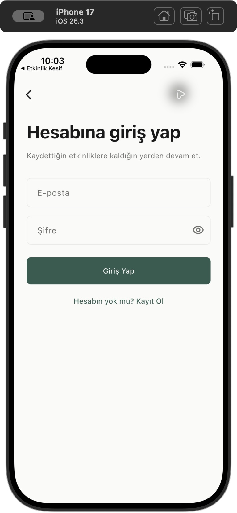
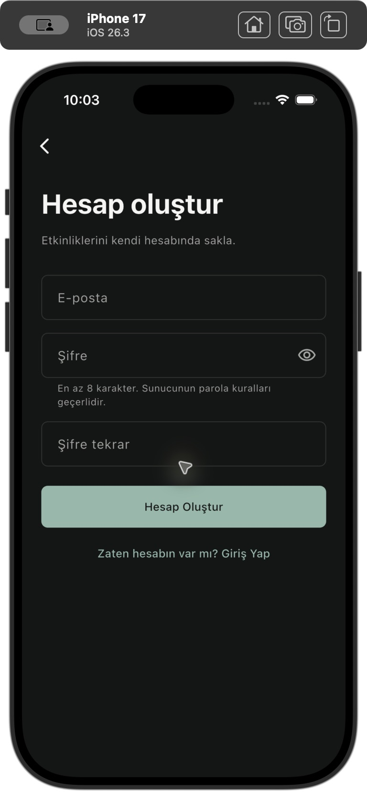
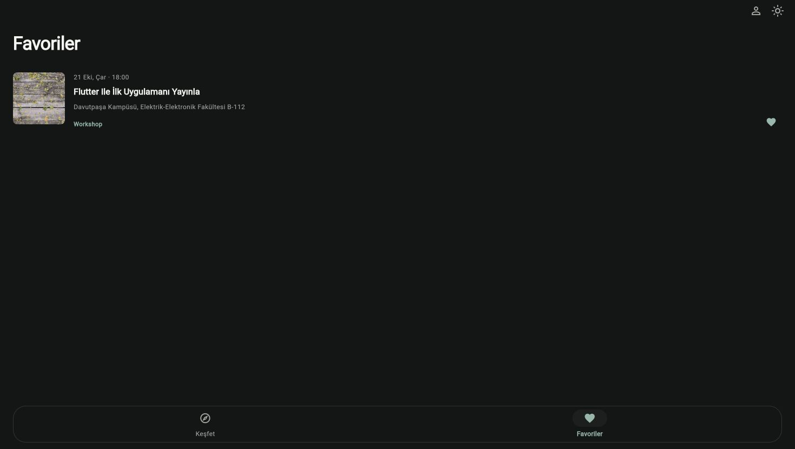
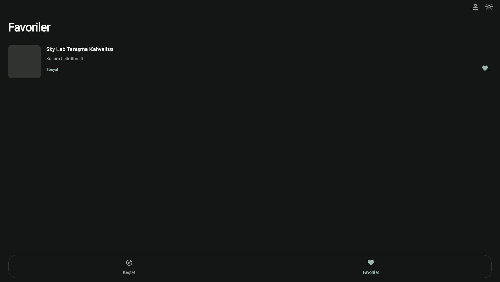

# MOBILAB — E-posta ve şifre geçişi

25 Ekim 2026. Commit/push veya canlı Pages deploy yapılmadı. Önceden bulunan kullanıcı değişiklikleri korundu.

## Yeni akış

Giriş: e-posta, şifre, göster/gizle. Kayıt: bunlara ek şifre tekrarı. Supabase `signInWithPassword` / `signUp` çağrılır. Form e-postayı trim eder; parolayı aynen gönderir. Yeni şifre için en az 8 karakter, eşleşme ve sunucu politikası gerekir. Mevcut hesaba girişte yeni kayıt uzunluğu şartı uygulanmaz. Loading, çift gönderim koruması, güvenli Türkçe hata ve tekrar deneme bulunur. Gerçek SDK Session olmadan başarı gösterilmez. OTP ekranı, kod, resend ve süre sayacı kaldırıldı.

Confirm Email proje sahibince kapatılmış; public settings üzerinden salt okunur doğrulandı. Dashboard, RLS veya SQL değiştirilmedi. Kayıt/giriş SMTP kullanmaz. E-posta sahipliği doğrulanmış kabul edilmez. Çalışmayan parola sıfırlama butonu eklenmedi.

## Değişen dosyalar

Bu görevdeki değişiklikler:

- `lib/features/auth/data/auth_repository.dart`: parola endpoint’leri, gerçek session ve güvenli hata eşleme.
- `lib/features/auth/controllers/auth_controller.dart`: giriş/kayıt doğrulama ve busy/session yönetimi.
- `lib/features/auth/presentation/screens/auth_screen.dart`: iki form, görünürlük ve autofill/klavye davranışı.
- `lib/app/app.dart`: kullanılmayan OTP config bağlantısı kaldırıldı.
- `lib/core/config/otp_config.dart`: kaldırıldı.
- `config/supabase.example.json`, `tool/build_web.py`, `.github/workflows/flutter_pages.yml`: eski OTP_LENGTH ayarı kaldırıldı.
- `pubspec.yaml`: açıklama güncellendi; bağımlılık eklenmedi.
- `tool/skeleton_preview.dart`: preview fake’i yeni repository arayüzüne uyarlandı.
- `test/auth_controller_test.dart`, `test/auth_favorites_widget_test.dart`, `test/helpers/account_fakes.dart`, `test/supabase_repositories_test.dart`, `test/theme_screens_test.dart`, `test/public_demo_config_test.dart`: parola/session regresyonları.
- `test/otp_length_test.dart` kaldırıldı; `test/password_form_test.dart` eklendi.
- `tool/test_public_demo_tools.py`: config araç testleri yeni ayarlara uyarlandı.
- `README.md`, `docs/teslim.md` ve bu rapor/kanıtlar güncellendi.

Başlangıç kaynak hash’leriyle karşılaştırma: lib altında yalnızca app’in OTP bağlantısı ve auth dosyaları değişti/kaldırıldı. Etkinlikler, favoriler, tasarım, public config ve diğer lib dosyaları bu görevde değiştirilmedi. Başlangıçtan gelen diğer uncommitted değişiklikler Git status’ta korunuyor.

## Otomatik doğrulama

| Kontrol | Sonuç |
|---|---|
| flutter pub get | Başarılı |
| flutter analyze | No issues found |
| flutter test | 230/230 başarılı |
| python3 -m unittest tool/test_public_demo_tools.py | 7/7 başarılı |
| Yerel config olmadan geçici kaynak kopyası | pub get, analyze ve 230 test başarılı |
| Varsayılan public config ile web release | Başarılı |
| Varsayılan public config ile iPhone 17 run | Başarılı, Xcode 10.3 sn |
| git diff --check | Temiz |

Geçici kopya, uncommitted güncel kaynakları da içerir; eski GitHub HEAD’i test edildiği iddia edilmez. Yalnızca geçici kopyada ayrı iOS bundle kimliği/display name kullanılarak mevcut kullanıcının oturumuna dokunmadan form görselleri incelendi. Yerel özel JSON değiştirilmedi; hash’i aynı, Git tarafından ignored. Açık Dart define/file override desteği ve testleri korunuyor. Bu görevde ayrı override ile canlı kayıt testi yapılmadı; public defaults kullanıldı.

Parola doğrulama, başarılı/başarısız giriş/kayıt, ağ hatası ve retry, yinelenen istek engeli, session/no-session, çıkış/hesap değişimi, favori erişim ve gecikmiş yanıt izolasyonu, public config, light/dark, 320px klavye/overflow testleri kapsanır. Artık geçerli olmayan OTP testleri değiştirildi; eski test sayısı aynen korunduğu iddia edilmez.

## Gerçek Supabase ve UI kanıtı

Kullanıcının açık onayıyla en fazla üç yeni QA hesabı oluşturuldu. Mevcut hesaplara yazma, veri silme, parola değiştirme veya favori taşıma yapılmadı. Sentetik QA adresleri kullanıldı; e-posta/SMTP gönderilmedi.

- A/B kayıt ve parola girişi HTTP 200 + gerçek Session.
- Yanlış parola HTTP 400 ve session yok; tekrar kayıt HTTP 422 `user_already_exists` ve session yok.
- A kendi favorisini yazdı; B aynı kullanıcının SELECT’inde boş sonuç aldı, A adına INSERT HTTP 403 ile reddedildi, DELETE A kaydını silemedi. A’nın kaydı yerinde kaldı. B kendi kaydını yazabildi.
- A logout/relogin sonrası aynı UUID ve aynı favoriyi aldı. Anon favori SELECT HTTP 401 ile reddedildi.
- C hesabı gerçek Flutter web kayıt formundan oluşturuldu. Favori eklendi; tam sayfa reload sonrası Hesabım ve favori geri geldi.
- Web UI’de çıkış sonrası kişisel liste temizlendi. A’nın formdan parola girişi sonrası yalnızca A’nın favorisi göründü; C’nin favorisi görünmedi.
- Test sonunda yalnızca A/B/C’nin geçici favorileri kendi session’ları ve user_id/event_id filtreleriyle silindi. Üç hesabın da favorilerinin boş olduğu HTTP 200 ile doğrulandı.

Ayrıntılı HTTP/boolean kayıtları yerel QA dosyasında korunur; GitHub’a yayımlanmaz. Bu testler gözlenen erişim davranışını kanıtlar; Dashboard policy metninin tamamının incelendiği anlamına gelmez. QA hesapları Auth içinde kalır; hesap silme/admin işlemi yapılmadı. Geçici kimlik bilgisi dosyası repo dışında 0600 tutuldu ve test sonunda silindi. Kaynaklarda QA e-posta/parola/token sızıntısı taraması boş; uzun secret/JWT/private-key örüntüsü taraması da boş. Public istemci URL/key gizli sayılmaz; gerçek değerler rapora eklenmedi.

## Simülatör ve görseller

Asıl uygulama varsayılan `flutter run` parametreleriyle iPhone 17’de derlendi/açıldı. Önceden açık kullanıcının Hesabım durumu ve kayıtlı favorisi korundu; bu kullanıcıdan çıkış yapılmadı. Ayrı QA uygulamasında boş giriş/kayıt formları iki temada incelendi. Native secure TextField’e otomasyonla parola yazmak güvenilir olmadığından iOS’ta uçtan uca gerçek parola gönderimi tamamlandı diye sunulmaz; aynı Flutter akışı gerçek web UI + canlı API ile doğrulandı.

## Eski OTP hesapları ve kalan manuel kabul

Eski hesabın otomatik parolası olmayabilir. UUID/favoriler silinmez ve yeni hesaba taşınmaz. Aktif oturumla desteklenen `updateUser(UserAttributes(password: ...))` veya kimliği güvenle doğrulayan yetkili sunucu tarafında aynı UUID’ye admin `updateUserById` kullanılabilir. Sunucunun reauthentication/current-password kuralları atlanmaz; bu geçiş hiçbir mevcut hesaba uygulanmadı. [Ayrıntılı güvenli geçiş](../../teslim.md#eski-otp-hesapları-için-geçiş).

Kalan manuel adımlar: eski kullanıcının kendi parolasını güvenli belirlemesi; iPhone’da elle gerçek parola girişi; fiziksel iOS/Android kabulü; kullanıcı commit/push yaptıktan sonra online CI/Pages yayını. SMTP reset bilinçli olarak yoktur. Yeni ücretli servis, domain, plan veya eklenti açılmadı.

Son Git status kaydı yerelde tutulur; GitHub’a yayımlanmaz. Git HEAD başlangıçla aynı; çalışma dizini önceden olduğu gibi değişiklikler/untracked dosyalar içeriyor. Hiçbir dosya stage edilmedi; commit/push yapılmadı.
