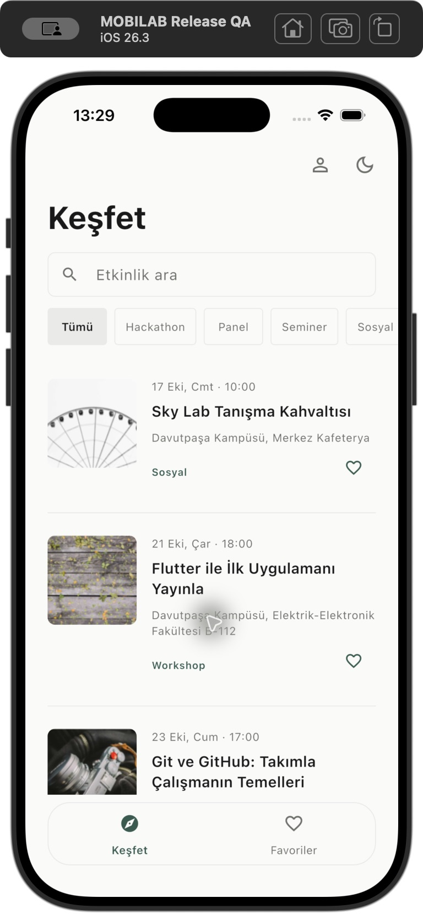
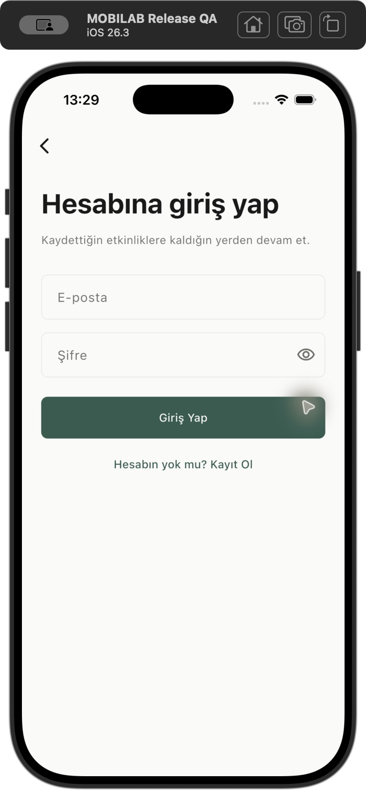
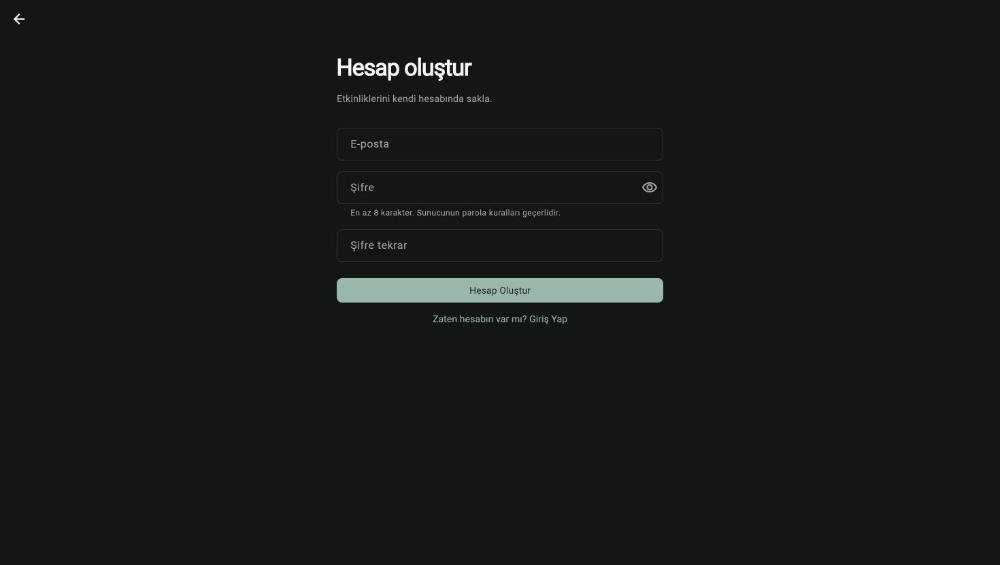
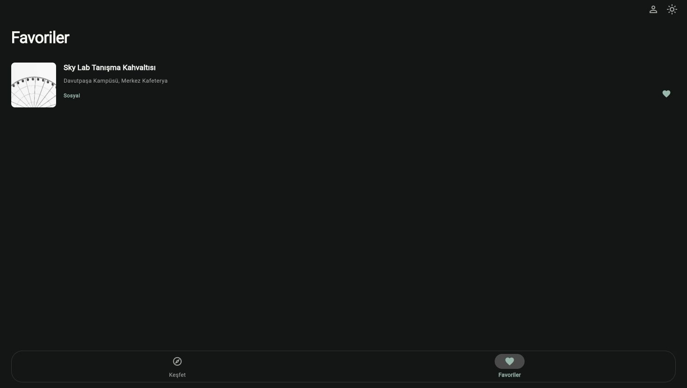
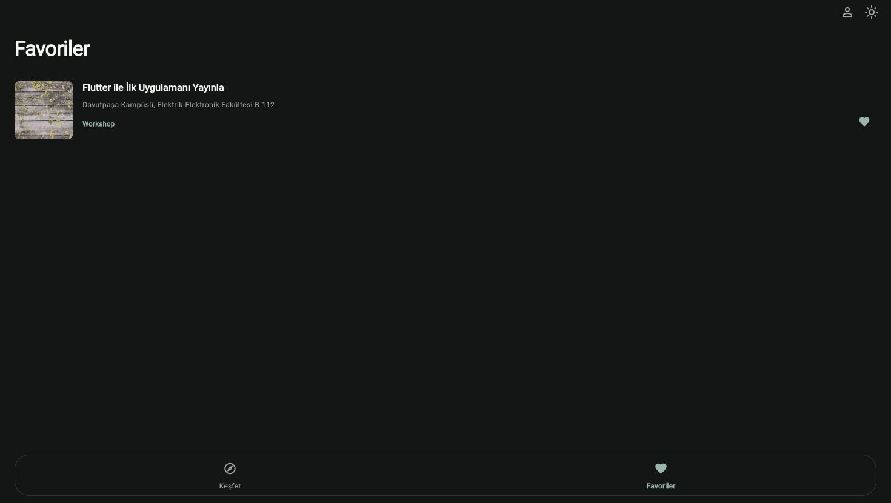

# MOBILAB — Son yayın öncesi denetim

25 Ekim 2026, Europe/Istanbul. **READY TO COMMIT** — Yerel kod, testler ve güvenli staging hazır. Bu karar remote’un güncellendiği veya GitHub Actions/Pages’in canlı başarıyla çalıştığı anlamına gelmez. Commit/push ve repository yayın ayarları kullanıcıya bırakıldı.

## Git ve denetimin kapsamı

- Kök: `/Users/cigdemgokdas/Desktop/Etkinlikler`; branch `main`.
- Origin: `https://github.com/cigdem-gokdas/Etkinlikler.git`.
- Yerel HEAD ve salt okunur `git ls-remote` ile doğrulanan remote main/HEAD: `0277ae4d98f5ecfa694da80c8ad574928e06048e`.
- Güncel uygulama değişiklikleri index’te, remote eski sürümde. Başlangıçta 96 staged dosya vardı; kullanıcı değişiklikleri korundu. Index yaması repo dışında yedeklendi. Hard reset/clean, commit veya push yapılmadı.
- `pwd`, root/branch/remote/status, cached stat/check/name-only ve unstaged name-only incelendi. Son staging kontrolünde unstaged değişiklik kalmadı; yerel ignored dosyalar yerinde.

## Güvenlik ve hariç tutulanlar

Yalnızca diff değil, tüm Git index dosyaları `git cat-file blob` ile tarandı. Secret-key/JWT/Resend/private-key desenleri, parola/token/SMTP alanları, e-posta adayları, geçici/build dosya yolları, eklenen belgeler ve son düzeltmeler incelendi. Tarama adayları değerleri gösterilmeden dosya/satır/tür olarak sınıflandırıldı. Yapılan tarama ve incelemede gerçek secret veya kullanıcı session’ı bulunmadı; bu, bilinmeyen tüm sır türlerini tespit eden matematiksel bir garanti değildir.

İki `sb_secret_` eşleşmesi `test/public_demo_config_test.dart` ve `tool/test_public_demo_tools.py` içindedir. İçerik incelendi: ikisi de kısa, açıkça fixture olarak adlandırılmış, geçersiz sunucu anahtarının reddini sınayan sentetik değerlerdir. Gerçek anahtar değiller; testler korundu, açıklayıcı yorum eklendi. Key rotasyonu gerektiren sızıntı tespit edilmedi.

Diğer eşleşmeler SDK argüman/alan isimleri, güvenli parola geçişinin dokümantasyonu, sentetik transport session’ları, example/invalid alan adlı test adresleri ve AppIcon dosya adlarındaki `@2x` gibi yanlış e-posta eşleşmeleridir. Giriş hint’i örnek adrestir. Gerçek kişisel e-posta/parola çifti, SMTP/Gmail/Resend sırrı veya özel anahtar bulunmadı.

Index’teki 70 rapor ekran görüntüsü görsel iletişim sayfalarında incelendi; kişisel hesap e-postası, parola veya token görünmedi. Küçük yazıların her pikselini garanti eden OCR iddiası yoktur; yalnızca OCR’a dayanılmadı. Uygulama ikonları/branding de bilinen logo kaynaklarıdır. Yeni denetim görüntüleri ayrıca görsel olarak kontrol edildi.

Aşağıdaki dosyalar diskte korundu, index ve dağıtım dışında tutuldu:

- `config/supabase.local.json` — önceden ignored, içeriği değiştirilmedi ve raporlanmadı.
- `docs/reports/password-auth/live-results.json`.
- `docs/reports/password-auth/git-status.txt`.

Son iki dosya için `.gitignore` içine yalnızca tam yollarına özel kurallar eklendi. Bu yerel kayıtlara public rapordaki bağlantılar kaldırıldı. Dosya hash’leri başlangıçla aynı. Build artefact’i, geçici QA dosyası veya local config stage edilmedi. Bu denetimin QA parolaları/token’ları ayrı, repo dışı 0600 geçici dosyada tutulup test sonunda silindi; kaynaklar ve web build bunlara karşı tarandı.

## Public config ve temiz dağıtım

Kaynakta bulunan anahtarın `sb_publishable_` tipinde olduğu değerini göstermeden doğrulandı. Public ayarlar merkezi `SupabaseConfig` katmanındadır. Publishable key istemci kullanımı içindir; session ve RLS yerine geçmez. [Supabase API anahtarları](https://supabase.com/docs/guides/getting-started/api-keys).

Öncelik gerçek Flutter derleyicisiyle sentetik probe kullanılarak sınandı: **CLI `--dart-define` > JSON `--dart-define-from-file` > public defaults**. Probe yalnızca geçici test harness’iydi, repo’ya eklenmedi. Açık boş/geçersiz config hata verir. Gerçek yerel override ile mevcut config testlerinin ayrıca 7/7’si geçti; yerel JSON değiştirilmedi.

Güncel **Git index’inin tamamı**, blob içerikleri ve executable modları korunarak `/private/tmp/mobilab-release-audit/distribution` klasörüne çıkarıldı. `.git`, local config, hassas QA kayıtları, build/cache dosyaları kopyalanmadı. Bu, henüz push edilmemiş staged kaynakların izole dağıtım simülasyonudur; gerçek remote clone diye sunulmaz. İlerleyen belge/yorum/workflow düzeltmeleri de son index’le eşleştirildi; uygulama davranış kodu değiştirilmedi.

Temiz kopyada:

| Kontrol | Sonuç |
|---|---|
| `flutter pub get` | Başarılı |
| `flutter analyze` | No issues found |
| `flutter test` | **230/230 başarılı** |
| `python3 -m unittest discover -s tool -p 'test_*.py'` | **7/7 başarılı** |
| Public defaults ile temiz iOS build/launch | Başarılı; Xcode 36.3 sn |
| `bash tool/run.sh -d <QA cihaz ID> --no-resident` | Başarılı; Xcode 14.1 sn |
| Pages `--base-href /Etkinlikler/` web release | Başarılı; 22.5 sn |
| Sentetik config öncelik probe’u | 1/1 başarılı, ana test sayısına dahil değil |
| Gerçek yerel config override testleri | 7/7 başarılı, ana test sayısına dahil değil |
| Güncel fotoğrafların Flutter codec denetimi | 1/1 başarılı, 14 fotoğraf decode edildi |
| `git diff --cached --check` | Temiz |

Flutter 3.47.7 stable / Dart 3.13.5 kullanıldı. Flutter Action kaynak kodundaki resmi güncel manifest adresinden Linux ve macOS için bu sürümün varlığı doğrulandı. Bağımlılıkların beşinde daha yeni sürüm bildirimi var; çözümleme ve test hatası değildir, dependency güncellemesi yapılmadı. Web tree-shaker’ın CupertinoIcons font uyarısı build’i durdurmadı; uygulama Material ikonlarıyla çalıştı.

## Canlı Supabase auth ve RLS

Önceki üç QA hesabının parolaları silinmiş ve önceki onay sınırı tüketilmişti. Kullanıcı bu denetim için **iki yeni QA hesabına ayrıca açık onay verdi**. Tam iki hesap açıldı; mevcut hesaplara, favorilere veya parolalara yazılmadı. E-posta/OTP/SMTP gönderilmedi, Dashboard veya plan ayarları değiştirilmedi.

Public ayar endpoint’i: email enabled, signup açık, Confirm Email kapalı. Kayıt A/B HTTP 200 ve gerçek session; parola girişi A/B HTTP 200. Session rolü yalnızca `authenticated`, service-role değil. Public key ile admin kullanıcı listesi isteği HTTP 401, anon favori SELECT HTTP 401 ile reddedildi; hiçbir kullanıcı listesi alınmadı.

| Canlı işlem | Sonuç |
|---|---|
| A ve B kendi favorisini ekler | HTTP 201, yalnızca kendi user_id |
| B, A’nın favorisini SELECT eder | HTTP 200, boş |
| A, B’nin favorisini SELECT eder | HTTP 200, boş |
| Başkasının user_id’siyle INSERT, iki yön | HTTP 403; açık row-level security hatası |
| Başkasının favorisini DELETE, iki yön | HTTP 200, boş; sahibinin kaydı hâlâ yerinde |
| Yanlış parola | HTTP 400, session yok |
| Kayıtlı adresle yeniden kayıt | HTTP 422, session yok |
| Test sonunda iki hesabın geçici favorilerini silme | Başarılı; her iki listede HTTP 200 ve sıfır kayıt |

Bunlar gerçek sunucu erişim davranışını ve RLS reddini kanıtlar. Yetkili DB katalog/policy metni erişimi kullanılmadı; tüm policy tanımlarının bağımsız DDL denetimi yapıldığı iddia edilmez. `supabase/favorites.sql` çalıştırılmadı. QA Auth hesapları kalır; hesap silme yetkisi kullanılmadı. Geçici favoriler temizlendi ve yeni QA kimlik bilgisi dosyası silindi.

Gerçek Flutter web UI’de A’nın yanlış parola mesajı, doğru parola ile tekrar girişi, favorisinin görünmesi, tam sayfa reload sonrası aynı oturum/favorinin dönmesi doğrulandı. Çıkışta liste temizlendi. B ile girişte yalnızca B’nin farklı favorisi göründü. Yeni kayıt formu açıldı; gerçek kayıt endpoint’i API testinde iki hesap için doğrulandı. Web formundan üçüncü hesap açılmadı.

## MOBILAB API ve arayüz

Bu denetimde yeniden alınan canlı sonuç: sayfa 1 HTTP 200 / 10 kayıt / hasMore=true; sayfa 2 HTTP 200 / 6 kayıt / hasMore=false; toplam 16. On altı etkinliğin detail GET’i ID ile eşleşti. On dört fotoğraf HTTP 200 ve Flutter codec decode başarılı. `evt-007` imageUrl null; `evt-015` fotoğrafı HTTP 400. Rastgele fotoğraf eklenmedi. Canlı web aramasından null görselli Figma etkinliğinin detayına gidildi; metin, tarih, konum ve açıklama fotoğrafsız fallback üzerinde okunur şekilde açıldı.

`q=Flutter` üç sonuç ve eşleşen başlıklar, `category=Workshop` altı sonuç ve eşleşen kategoriler, `/categories` altı kategori döndürdü. Canlı API’de search/category/list/detail kontrol edildi. %69/%70 pagination eşiği, tek istek, scroll koruma, retry/skeleton, bozuk/null görsel, dinamik detay, dark/light ve overflow otomatik regresyonlarda geçti.

Temiz, ayrı iPhone 17 simülatörü oluşturuldu; index’teki bundle ID/sources değiştirilmeden ilk kurulum ve onboarding açıldı. Mevcut kullanıcının asıl simülatör verileri kullanılmadı. İlk liste çağrısında API sunucu hatası gösterdi; **Tekrar dene → loading → canlı liste** akışı başarılı oldu. Bu gözlem API’nin kesintisiz olacağı sözü verilemeyeceğini gösterir; evaluator’a config hatası gibi sunulmaz. Oturumsuz keşif ve favoriden giriş formuna yönlendirme gerçek iOS UI’de doğrulandı. iOS secure-field otomasyonu yerine gerçek credential gönderimi web UI/API ile doğrulandı; fiziksel cihaz/Android kabulü yapılmadı.

## CI ve Pages

CI, `main` push ve PR için ubuntu-latest üzerinde Flutter 3.47.7 kurar; pub get, analyze, Flutter test ve bu denetimde eklenen Python araç testlerini çalıştırır. Local config veya secret gerektirmez. Token izni `contents: read`; checkout persist-credentials kapalıdır.

Pages ayrı workflow’dur. Public repo + main koşulu, opt-in `PAGES_ENABLED=true` veya manuel dispatch vardır; bu denetimde etkinleştirilmedi. Build önce aynı kalite kontrollerini geçirir. Python build aracı public defaults kullanır; opsiyonel URL/key vars’ları yalnızca açık override içindir. Repo alt yolu `/Etkinlikler/`, kullanıcı-site repo adı için `/`, self-hosted renderer, `.nojekyll`, doğru `build/web` artifact’i ve 1 günlük retention hazırdır. Deploy job `needs: build`, github-pages environment ve yalnızca gereken `pages: write` / `id-token: write` izinlerini içerir. [GitHub custom workflow gereksinimleri](https://docs.github.com/en/pages/getting-started-with-github-pages/using-custom-workflows-with-github-pages).

Workflow YAML’leri parse edildi ve komut/koşul/izinler incelendi. Bu, online GitHub Actions run başarısı değildir. Commit/push sonrası CI ve seçilirse Pages Deploy sonucu ayrıca kontrol edilmelidir.

Yerel gerçek web release `http://127.0.0.1:8768/Etkinlikler/` altında açıldı; onboarding, anonim API erişimi, giriş/kayıt formları, parola ile giriş, hesap izolasyonu ve refresh çalıştı. Kullanılan kök URL’de tam reload 404 üretmedi. Uygulama içi Navigator geçişleri sunucudan yeni deep-link path istemiyor. GitHub host’unda yayın sonrası gerçek URL/CORS/refresh kabulü yine gereklidir.

Web build’de public key mevcut; secret/private-key/JWT/Resend desenleri ve QA e-posta/parola/token’ları bulunmadı. Artifact 40 dosya içeriyor ve symlink yok. Tarayıcıya verilen parolanın Supabase’e HTTPS ile gönderilmesi normal auth akışıdır; parolalar kaynak dosyasına veya loga gömülmedi.

## Yapılan küçük düzeltmeler ve son staging

Bu denetimde runtime özellik/tasarım değişikliği yapılmadı. Yalnızca:

- İki QA dosyası için tam yol ignore ve public raporda yerel dosya bağlantılarını kaldırma.
- İki sahte secret fixture’a açıklayıcı yorum.
- CI/Pages’e mevcut Python testlerini ekleme.
- README/teslim rehberinde açık config önceliği, güncel kabul sonucu ve bu rapor bağlantısı.
- Bu rapor ve kişisel bilgi içermeyen ekran kanıtları.

Son index **305 dosya**, HEAD’e göre **105 staged değişen dosya** içerir. Güvenli değişiklikler staging’e alındı. Son index tekrar tarandı; iki yerel QA dosyası/local config index’te yok, unmerged dosya yok, diff check temiz. Kullanıcının önceki staged değişiklikleri korundu. Başlangıçtaki HEAD aynı; commit/push yok. Yerel/QA dosya hash’leri korunuyor.

## Değerlendirici kurulumu ve kalan işler

```sh
git clone https://github.com/cigdem-gokdas/Etkinlikler.git
cd Etkinlikler
flutter pub get
flutter run
```

Bu deneyim kullanıcının **güncel staging sürümünü commit/push etmesinden sonra** geçerlidir. Flutter/cihaz araçları kurulmuş olmalıdır; birden çok cihaz varsa Flutter cihaz seçimi ister. Public demo için local config veya yeni Supabase projesi gerekmez. Her kullanıcı kendi hesabıyla favorilerini aynı projede saklar.

Confirm Email kapalı olduğundan e-posta sahipliği doğrulanmaz; SMTP olmadığı için parola kurtarma yoktur. Eski OTP hesabına otomatik parola atanmaz; mevcut UUID korunarak [güvenli manuel parola geçişi](../../teslim.md#eski-otp-hesapları-için-geçiş) gerekir. Bu sınırlama README’de açıklandı.

Kullanıcının son adımları: commit/push; GitHub Actions CI sonucunu görmek; yayın istenirse Settings → Pages → GitHub Actions ve isteğe bağlı PAGES_ENABLED değişkeni/manuel workflow. Repository ayarları veya deploy bu çalışmada değiştirilmedi. Daha geniş platform kabulü (fiziksel cihaz/Android), eski hesap parola geçişi ve harici servis kota/erişilebilirliği teslimin bilinen sınırlarıdır. Yeni ücretli servis/plan/domain açılmadı.

## Ekran kanıtları







**READY TO COMMIT**
